# 视频先验与PPO融合的Orca方块抓握实验总报告

[总目录](README.md) · [完整数据](all_results.md) · [核心源码讲解](source_guide.md) · [数据文件说明](data_guide.md)

整理日期：2026-10-09。本文汇总已经完成的工作，没有为写报告重新训练，也没有更改已有评分。主要证据来自S02和S04；S03已完成部分用于说明开发过程与适用边界。这里讲的是同一个项目的完整故事，不是两个编号的简单对比。

## 1. 这个项目到底在做什么

你的目标是：**先从视频得到一个大体合理的抓法，再让PPO根据当前实际情况进行调整。**

为什么值得做？机械手从完全不会开始，靠试错发现“先弯哪根手指、什么时候合拢、怎样不把方块挤走”很费交互。视频里已经有可借鉴的动作，但人的手和Orca不一样，视频也不能直接给出机械手需要的关节目标、接触力和实时纠错。因此需要先转换，再通过仿真学习。

本项目走通了两条路线：

- **BC后PPO**：先模仿示范，把“基本怎么抓”学进网络；然后让这个网络继续试错。执行时由一个网络给完整动作。
- **参考加残差PPO**：视频参考始终参与每一步的决策；网络只给一个有界修正量。执行时两部分相加。

第二条就是你说的“大的由视频决定，微调由PPO决定”。目前的大动作来自**离线处理后的时间参考轨迹**，不是摄像头在每一步识别新画面后重新决定抓法。

现在可以做出的核心结论是：在匹配先验的Orca方块仿真任务、有限在线训练预算下，两种融合方法都能明显提高平均成功率。当前最新新初态测试中，纯PPO为31.30%，BC后PPO为84.00%，参考加残差PPO为85.10%。后面会解释这些数的条件、证据和边界。

## 2. 一条完整链路怎么走

```text
HIC20原视频 + 已有手部/物体三维跟踪 + 同序列物体网格
    ↓ 数据对齐（单位、帧号、手与物体坐标）
DexMV位置优化器：人手跟踪 → Adroit中间手型的拟合点
    ↓ 转成相对物体的位置关系
Orca逆运动学：在Orca关节限制内拟合指尖轨迹
    ↓ 碰撞/物理检查与E01有界仿真校正
Orca关节参考轨迹 q_ref(t)
    ├─ 扰动回放 → 筛选成功示范D01 → BC → PPO → 完整动作
    └─ 每个控制时刻与PPO修正相加 → 关节限幅/变化限速 → 执行
                                       ↓
                              物理状态、模拟触觉、奖励
                                       ↓
                                  PPO继续更新
```

**DexMV在当前链路里主要提供的是重定向工具，不是另一个在线决策网络。** 这里没有在每一步同时运行一个DexMV的TRPO策略和一个PPO策略，也没有把DAPG直接加到PPO损失里。

原先探索过的TRPO/DAPG、旧36mm方块、旧手型和其他任务属于历史路线。当前正式证据绑定的是下面这套Orca、53mm物体、参考和评分，不能把不同任务的最好成绩拼成一组。

## 3. 视频提供了什么，又没有提供什么

### 3.1 来源不是几十段视频

使用HIC第20段视频。原视频186帧、30 FPS，选取第30至95帧的接近和夹持阶段，约2.17秒，在仿真中重采样为1.5秒动作。

本轮使用已有公开跟踪结果及其DexMV转换产物，**没有重新从RGB像素训练或运行一套姿态识别系统**。所以准确描述应是“使用视频衍生的三维跟踪先验”，不能说已经验证了任意原始视频输入的全自动成功率。


视频物体是53mm的倒角魔方，仿真把它当作一个整体刚体，不模拟魔方各层转动。当前物体形状来自同序列OFF网格，没有为了方便抓握缩成旧版36mm方块。质量35g及摩擦参数是仿真设置，不是从画面中测出来的。

### 3.2 两种手不一样，靠什么对接

不是“人手第一个关节角复制给机器人第一个关节”。实际做法是：

1. 找到每帧手指相对物体的位置，例如拇指应该在物体哪一侧。
2. 将物体和目标点用同一个刚体变换放到Orca可够到的位置，不改变物体尺度。
3. 反过来求Orca的关节角，让其指尖尽量靠近目标，同时满足关节范围和碰撞限制。这叫逆运动学，简称IK。
4. 当前主要拟合拇指和食指；其他指不强行复制人手姿态。后续PPO动作仍有17个执行器通道。
5. 连续求解整段动作并插值；不是只提取一个闭合末姿态。

参考来源、物体姿态、起手姿态、单位和模型哈希一并保存。换手或换物体后不能仅换文件名继续用同一批BC标签。

### 3.3 精度到底够不够

已有重定向链审计显示：对于实际使用帧，人手跟踪点到Orca的平均总位置偏差，拇指约7.10mm、食指约11.48mm；末帧分别约1.88mm和7.15mm。它们是运动学代理点误差，不是表面接触误差，还不包括原始跟踪本身的误差。

这解释了为什么不能说“末帧某个误差不到1mm，整个视频就很精确”。项目也试过直接用人手点提高拟合精度，食指平均误差降到约3.88mm，但三个初态仍只保持约6.9到10.5秒后掉落。**姿态像得更准，不等于接触更稳。**

外观网格与碰撞几何也要分开：STL/OFF负责显示外形，碰撞代理负责物理接触。物体代理的既有采样几何误差约0.911mm，但这不是所有位置的严格数学上界。当前成绩只对所用碰撞模型有效，不能自动推成真实手的精度或安全性。

详细证据见[视频与物体对齐说明](../../orca_video_object_alignment.md)。

## 4. 为什么还要校正参考、制作数据集

### 4.1 先验不是原视频原封不动

从视频拟合出来的动作未必能在Orca的重力方向、指尖形状和摩擦条件下保持物体。因此E01在开发阶段围绕原参考搜索小幅关节偏置，用仿真检查保持时间和穿透，再得到更可执行的参考。

实际校正上限为每个被选关节0.12rad，约6.88度，作用在7个拇指/食指通道上；这是**开发时的参考搜索**。它与之后执行时的PPO残差上限0.08rad是两个不同环节，不能混为一谈。

E01也将部分屈曲关节向中性姿态打开50%，避免直接从完整抓牢的终点开始。起手不是完全张开，但仍需要建立有效抓握。最终基础动作应叫“视频重定向并经仿真校正的参考”。

### 4.2 D01数据集怎么来的

让校正参考在不同轻微扰动初态中回放64次，筛选出40条成功且满足当时几何门槛的轨迹。每条记录每一步的状态、教师动作和有效时间掩码。前30条用于BC训练，后10条用于验证。

这里的教师就是参考控制器，不是一个已经很强的PPO专家。40条示范来自**同一段来源视频的仿真回放**，不等于40段视频。按整条轨迹分训练和验证，能减少相邻帧混入两边的问题，但不能称作跨视频验证。

BC读取的是 `obs/action/active`：当时看到了什么、参考控制器给了什么动作、该时刻是否仍有效。仿真补齐了原视频不直接提供的关节速度、物体速度和模拟触觉。

## 5. 五种方法到底有什么区别

| 方法 | 训练前准备 | PPO是否更新 | 每一步最终动作由谁决定 |
|---|---|---|---|
| 纯PPO | 没有逐帧示范监督 | 是 | PPO给完整目标 |
| 仅BC | 用D01模仿4000次更新 | 否 | 模仿网络给完整目标 |
| BC后PPO | 同样先做4000次BC | 是 | 微调后的单一网络给完整目标 |
| 零修正参考 | 使用校正后的参考 | 否 | 直接播放参考 |
| 参考加残差PPO | 使用同一参考 | 是 | 每步参考加PPO的小修正 |

注意：纯PPO也共用这个任务的手物摆放和起手元数据，它不接收逐帧参考内容，但不是“场景设置完全没有来源示范信息”。

### 5.1 BC后PPO：老师教会以后，自己做

BC先将网络输出往示范动作靠近。代码对策略输出的均值和示范动作的反tanh值做平方误差训练；可以直观理解为“看同样的状态，尽量给出老师的动作”。每批各抽接近和保持阶段样本，避免几十秒保持数据淹没短暂合拢过程。

然后由PPO用环境奖励继续更新网络。执行时不再强制追随参考。因此它有机会学到不同于视频的抓法，也可能在长训中忘掉原先好用的行为。**BC后PPO不是没有PPO，也不是执行时两个动作相加。**

### 5.2 残差PPO：参考一直在，网络负责偏移

每个控制时刻使用：

```text
请求修正 = clip(PPO输出, -1, 1) × 0.08 rad
期望目标 = clip(当前参考角 + 请求修正, 关节下限, 关节上限)
执行目标 = 在上一时刻执行目标附近限制每步变化不超过0.1 rad
```

例如某个参考关节是0.60rad，PPO输出0.5，就请求增加0.04rad，得到0.64rad，再检查范围和变化速度。下个时刻重新围绕新的参考相加，不把所有修正一直累积。

这是明确的执行端残差架构。`requested_residual`记录请求修正；`effective_residual`记录实际执行目标减参考。由于后续限幅和限速，两者不一定相同，实际差值也不能简单等同于网络的0.08rad请求上限。

视频参考是一张按时间查的表，不是会根据新物体自行规划的基础策略。参考末帧之后保持，因此抓稳后的阶段主要是“固定基础抓型+状态相关修正”。

## 6. PPO如何拿数据、如何学

PPO的训练数据来自它自己在仿真中的交互：读取观测、输出动作、物理推进、获得奖励、记录下一状态。攒下一批轨迹后，利用奖励估计哪些动作比预期更好，再小步更新策略，重复这个过程。

视频不替代这个循环。BC路线改变初始网络；残差路线改变动作的解释和可搜索范围。两者都继续通过真实的仿真接触结果学习，而不是只凭“像不像视频”打分。

### 6.1 输入输出

- Actor是负责发动作的网络，输入123维，包括关节/控制历史、物体相对状态、指尖关系、阶段信息、参考通道和模拟触觉；输出17维。
- Critic是训练时估计长期收益的网络，输入140维，包含额外信息；它不是另一个独立控制手的策略。
- 两个网络的隐藏层均为128、128。残差组参考通道有效，纯PPO对应通道填零。保持计数从Actor的相应槽位移除，不直接给它答案。
- 模拟触觉有噪声、滤波和一个控制周期延迟，不是实际传感器采集。

### 6.2 当前真正生效的奖励

基础奖励是 `15×有效保持 - 50×终止`，再乘控制步长0.05秒。
前3秒可以加 `shaping×(3×接近程度 + 2×拇指接触 + 2×配对接触)`，同样乘步长。

“有效保持”要求物体离开支撑后，拇指与另一指配对接触，物体没有明显下落，也没有禁接触。终止包括明显掉落或非有限状态。这里没有“越像视频越高分”的姿态奖励，也没有在PPO更新中持续加BC损失。

代码有继承层：`orca_benchmark_env.py`里的历史奖励会被`orca_refit_env.py`覆盖，然后`orca_acquisition_env.py`加入前期辅助项。不能把每层出现的奖励全加起来解释。

### 6.3 当前训练配方

每个主比较模型的有限预算是163840个环境控制步；128个并行环境、展开长度20、4个小批次、每批4轮更新，折扣0.99、熵系数0.001。PPO核心使用Brax现成实现。

| 路线 | 早期正式配方(S02)学习率 / 初始探索std / shaping | 调优配方(S04权重来源) |
|---|---|---|
| 纯PPO | 3e-4 / 0.7 / 1 | 相同 |
| BC后PPO | 3e-5 / 0.3 / 1 | 7.5e-6 / 0.3 / 1 |
| 残差PPO | 3e-4 / 0.3 / 1 | 3e-4 / 0.7 / 0 |

std控制初始动作探索，不是物体位置扰动。shaping控制前3秒辅助奖励，0表示关闭。不同路线用了受控开发选出的不同配方，所以这些结果比较的是完整方法，不是只改变一个变量的因果试验。

物理采用CPU原生MuJoCo，借助回调接入JAX/Brax；网络训练使用GPU。不能因为使用JAX就说全部物理都在GPU上。数据接口使DexMV准备环境和PPO训练环境可以分离：准备好NPZ后，在`aero_rl`内训练，不必让两套依赖同时运行。

## 7. 实验任务与评分：什么才算抓住

任务是**固定腕座的Orca右手抓握并保持方块**。有17个执行器，其中包括一个可控腕转动关节，但没有让机械臂从桌面任意位置搬来物体。

| 项目 | 设置 |
|---|---|
| 物体 | 同源53mm方块，默认35g |
| 常规初态 | XY各±2mm扰动；各方法同一批测试位置 |
| 物理/控制周期 | 5ms / 50ms，即每个控制步10个物理子步 |
| 托板 | 2秒开始下移，3秒撤完 |
| 回合 | 最长40秒、800个控制步 |
| 原始成功 | 撤托后连续有效保持至少30秒，且40秒末仍有效 |
| 清洁成功 | 原始成功，并且撤托后每5ms无禁接触、手物穿透不超过3mm |

所以“视频播放了40秒”不等于保持了40秒，“中途最高保持超过30秒但最后掉落”也不算最终成功。原始成功以控制步判据为基础，清洁成功再检查物理子步，避免较粗采样漏掉接触问题。

“清洁”只是本实验的接触合格口径，不代表真机安全。手指间自碰撞尚未纳入保证，3mm也不是硬件安全标准。

## 8. 整个实验做到哪里

| 阶段 | 做了什么 | 状态及如何使用 |
|---|---|---|
| 前期可行性 | 跨手型重定向、物体对齐、碰撞代理、原生物理、参考校正与D01 | 已有产物；不把早期其他任务成绩混入正式表 |
| S02正式实验 | 50项训练、388项评估、77600回合，六条件及参考消融 | 完成；回答先验、参考与修正分别贡献什么 |
| S03受控开发与扩展 | 24个开发试验；40项确认训练；长预算及扩展测试 | 训练完成，评估477/738项后按用户要求停止；不称全矩阵完成 |
| S04新初态复测 | 取S03十个种子各自163840步检查点，在100个新初态测试五方法 | 41项评估、4100回合完成；没有重新训练 |
| 当前文档整理 | 重算S02/S04统计、图表、完整讲解、源码阅读包 | 文档工作，不新增成功回合或训练成果 |

S02种子1001..1010，测试初态40000..40199；S04种子21001..21010，测试初态81000..81099。S04不是S02同种子、同初态只改参数重跑，也不是全新抽训练种子的独立复现。

S02与S04共有81700条正式回合记录。这个总数描述保存数据量，不表示81700次独立训练，更不能跨条件求一个“项目总成功率”。S03历史数据另列，不重复加进这个数。

## 9. 总体效果：先验确实提供了起点

下面两列是同一研究的不同证据阶段，分别保留来源。主要关注各阶段内部路线的差异，而不是把跨阶段变化当作单因素改进。

| 方法 | S02常规条件清洁率 | S04新初态清洁率 | 作用 |
|---|---:|---:|---|
| 纯PPO | 29.30% | 31.30% | 无逐帧先验的在线学习基线 |
| 仅BC | 51.55% | 63.50% | 示范能给网络多少基础能力 |
| BC后PPO | 68.90% | 84.00% | 学会模仿后再交互能否提高 |
| 零修正参考 | 68.00% | 66.00% | 参考本身、不靠PPO的能力 |
| 参考加残差PPO | 69.80% | 85.10% | 基础动作与学习修正共同执行 |

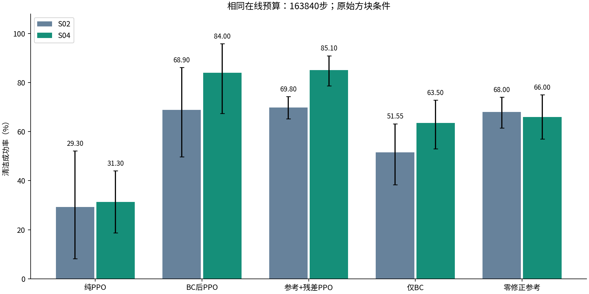

在最新复测中，仅BC到BC后PPO是+20.50个百分点；零修正参考到残差PPO是+19.10个百分点。它们说明不能把全部成绩都算成“只是视频本来就会抓”，也不能把全部成绩都算成PPO从零学来的。

但较早S02中，零参考到残差只提升1.80个百分点，原检验不支持显著增益。完整项目的正确叙述是：**先验基础能力稳定存在，PPO在其上的额外收益依赖训练配方与任务条件。**

## 10. 不是只看平均数：稳定性与统计

S04主三组各有10个独立训练种子，每份策略测试100个共同初态，均保留。仅BC也是10份网络；零修正参考是一个固定控制器，只有100回合，不能复制成十份当作十次独立训练。

| S04方法 | 均值 | 种子间标准差 | 最低/最高种子 |
|---|---:|---:|---:|
| 纯PPO | 31.30% | 19.89个百分点 | 1% / 62% |
| BC后PPO | 84.00% | 23.79个百分点 | 22% / 100% |
| 残差PPO | 85.10% | 5.86个百分点 | 75% / 94% |

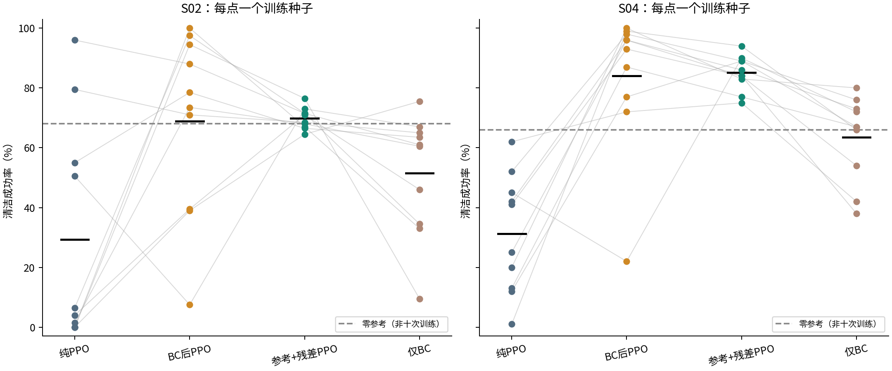

通俗地说：残差这组的十次训练更集中；BC后PPO有些训练很好，但也有较差的一次。这里的标准差是描述稳定性，不是额外做了一项“方差显著更小”的检验。

| S04原定重点比较 | 平均提升 | 95%差值区间 | 校正后p值 | 正提升种子 |
|---|---:|---|---:|---:|
| BC后PPO减纯PPO | +52.70个百分点 | +29.10到+72.50 | 0.005859 | 9/10 |
| 残差PPO减纯PPO | +53.80个百分点 | +38.80到+68.20 | 0.003906 | 10/10 |

95%区间表示统计估计的不确定范围，不保证下一次运行就落在其中。p值衡量在相应无差异检验模型下出现这样差异的罕见程度，不是“算法正确的概率”。同时检验多个主张会增加偶然命中的机会，所以使用Holm校正。

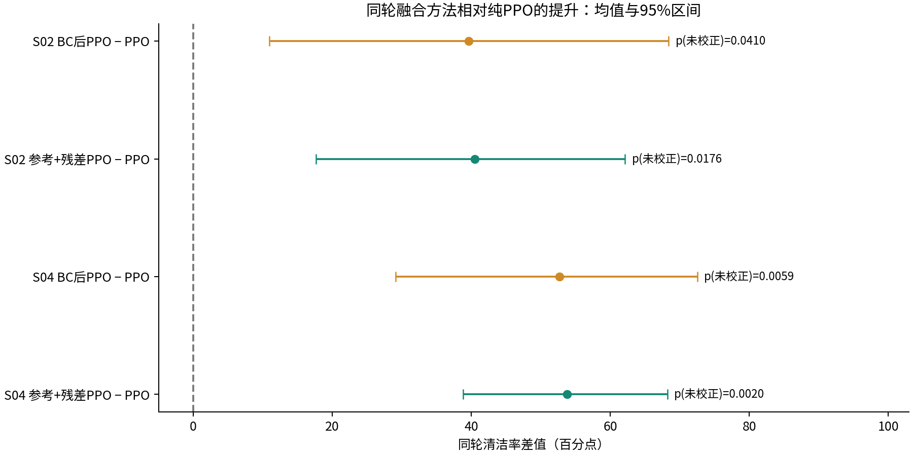

S02原定五项主比较使用Holm-5，残差减PPO校正后p=0.052734，未达到0.05。S04原定两项使用Holm-2，两项通过。不能隐去S02未通过的结果，也不能说p值变小全部来自算法变强。

**85.10%与84.00%仅差1.10个百分点，当前不据此宣布残差严格胜过BC后PPO。** 两者显著高于纯PPO，不等于两者互相之间也显著不同。

## 11. 学习过程：主要收益是少探索也能做得不错

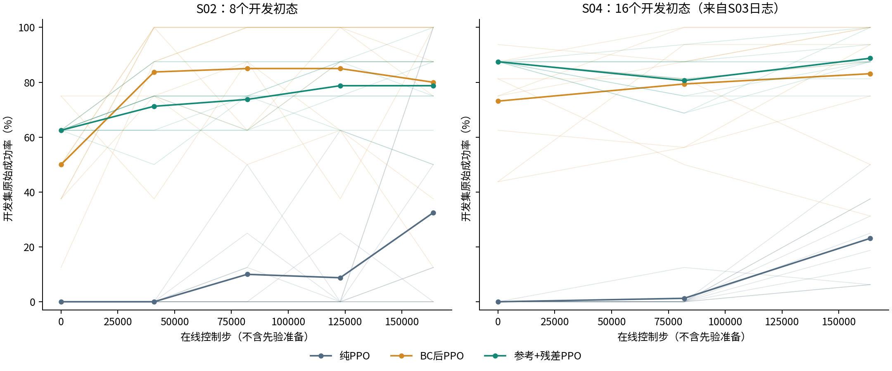

横轴是PPO在线控制步，不包含先验处理和BC训练。先验方法从零在线步就有一定能力，原因是前面已经做了准备，而不是网络凭空会抓。

曲线来自开发初态：S02是8个，S04所用训练日志是16个，不是两轮最终测试集的逐步评估。因此可以看趋势、起点和波动，但不宜精确断言“比另一轮少某某步达标”。粗线是种子均值，细线是每个训练种子。

在保存的开发检查点内，S04达到80%原始成功率的种子数分别是：纯PPO0/10、BC后PPO9/10、残差10/10。这是开发集描述，不替代最终测试成功率。

相同在线预算不等于相同总成本。BC有4000次监督更新，参考校正和D01回放也消耗计算；S03三条路线开发各花1310720在线步，总计3932160步。后来完整长训练已经发生的成本，也不能因为S04只用早期权重就抹掉。

## 12. 什么环节真的有用：参考消融

消融就是有控制地拆掉一个环节，看结果怎么变化。S02在常规条件下得到：

| 配置 | 清洁成功率 | 想回答的问题 |
|---|---:|---|
| 未校正参考+残差 | 22.20% | 不做仿真校正能否直接学好 |
| 线性合拢参考+残差 | 40.40% | 只有起点终点、去掉视频中间轨迹是否足够 |
| 校正参考、零修正 | 68.00% | 先验自身有多强 |
| 完整参考+残差 | 69.80% | 在这套配方中加入残差的总体效果 |
| 同一完整残差策略、执行修正减半 | 65.40% | 执行时改变修正幅度是否影响表现 |

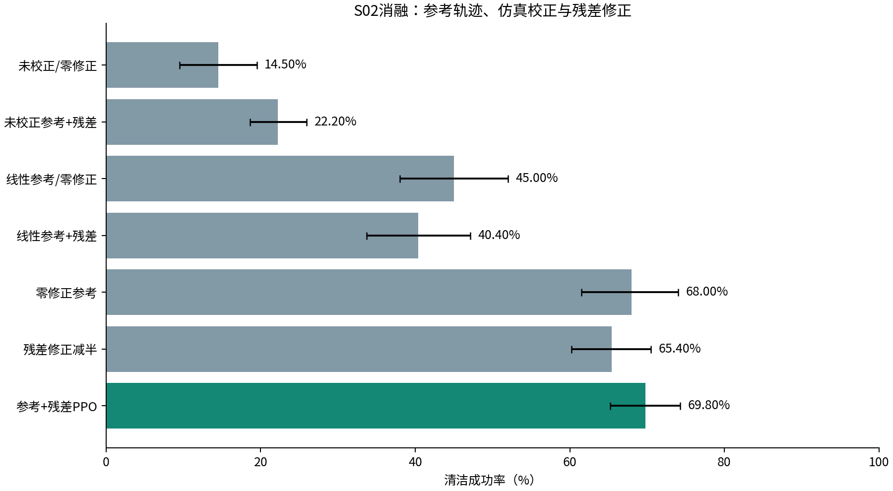

这些结果支持参考质量和时序过程的重要性。它们没有证明“任何视频都比人工设计轨迹好”，因为没有充分优化的人工抓法对照。修正减半退化说明策略依赖修正，但不能单独证明它靠实时反馈恢复了扰动。

## 13. 不同物理条件：不是每个场景都占优

S02所有策略只在常规条件训练，测试时改变一个条件，不重新训练。主路线的完整六条件如下，其他消融组见[完整数据表](all_results.md)。

| 条件 | 纯PPO | BC后PPO | 残差PPO | 零修正参考 |
|---|---:|---:|---:|---:|
| 常规±2mm | 29.30% | 68.90% | 69.80% | 68.00% |
| 位置±6mm | 21.00% | 59.80% | 37.10% | 28.50% |
| 朝向±10度 | 35.60% | 73.45% | 60.50% | 56.50% |
| 摩擦乘0.6 | 19.25% | 97.55% | 96.70% | 96.00% |
| 质量乘2 | 22.90% | 2.65% | 25.05% | 27.50% |
| 0.15N弱推力 | 29.15% | 68.85% | 69.50% | 67.50% |

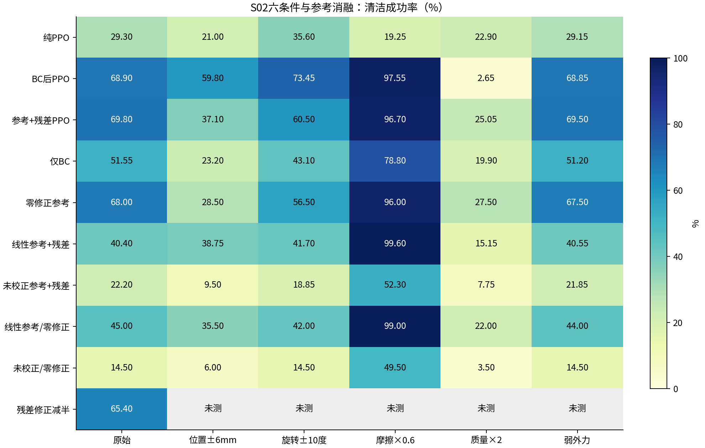

位置扩大后，参考相对物体容易偏离，残差下降明显。BC后PPO不被限制在参考附近，均值更高；但“限制范围导致全部差异”仍只是待验证解释，不是已隔离的因果结果。

质量加倍暴露了先验的边界。低摩擦反而让部分抓法更成功，可能与合拢时滑动和接触重新就位有关，但没有专项实验确认。**不能把“摩擦低”自动当作更难，更不能把这一项高分说成普遍抗滑能力。** 零参考在此已达96%，大部分能力不是新增PPO反馈产生的。

S04只新做常规条件。其文档里的五条件表来自S03历史数据：短预算两种融合都超过PPO的条件有4/5，质量加倍是反例。它不是S04又独立测完五个条件。

## 14. 长训练会怎样：保留对方法不利的证据

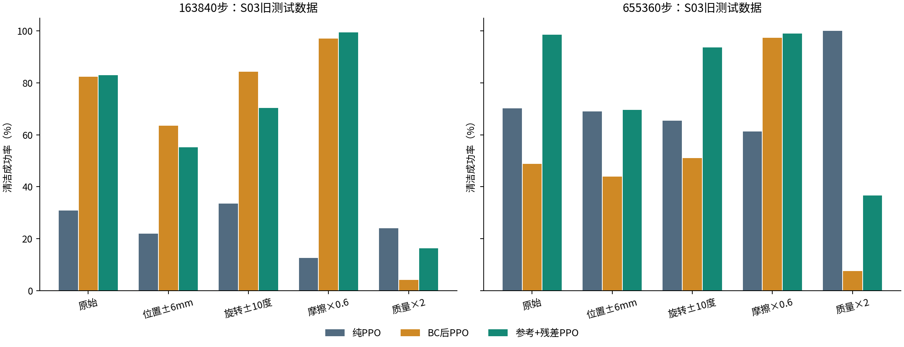

这张图使用S03已完成的五条件数据，同一次训练取163840与655360步权重。训练更久以后，纯PPO有机会找到不受参考限制的抓法；BC后PPO也可能退化。

长预算下，两种融合同时高于纯PPO的条件只有1/5。例如质量加倍时，纯PPO100%，BC后PPO7.60%，残差36.65%。所以不能把有限预算下的优势扩大成“充分训练后的性能上限一定更高”。

“BC遗忘”“参考限制过强”“奖励导致策略改变”都是值得检验的原因，但当前记录没有把它们逐个隔离。更稳妥的总结是：**匹配视频先验可帮助早期建立行为，但长期收益和迁移能力不是自动保证的。**

## 15. 抓住之外：接触、力、穿透与失败

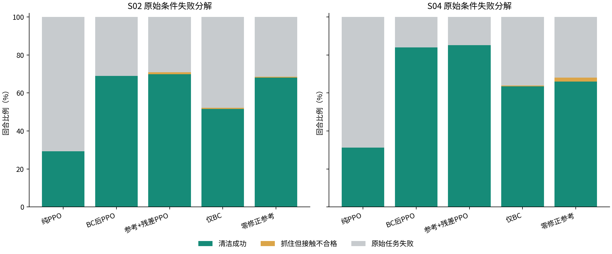

失败分成三个互斥类别：清洁成功、原始成功但接触不合格、原始任务失败。这里不把未标注的失败武断细分成“重定向错误”“力不够”等原因。

S04主三组原始成功率分别31.30%、84.00%、85.20%，对应清洁率31.30%、84.00%、85.10%。因此两种融合相对PPO的大幅差距不是靠3mm门槛大量扣掉PPO成功回合形成的。

| S04方法 | 平均最长有效保持 | 平均每回合指部峰值力 |
|---|---:|---:|
| 纯PPO | 16.25秒 | 37.73N |
| BC后PPO | 36.43秒 | 25.36N |
| 残差PPO | 36.55秒 | 14.33N |

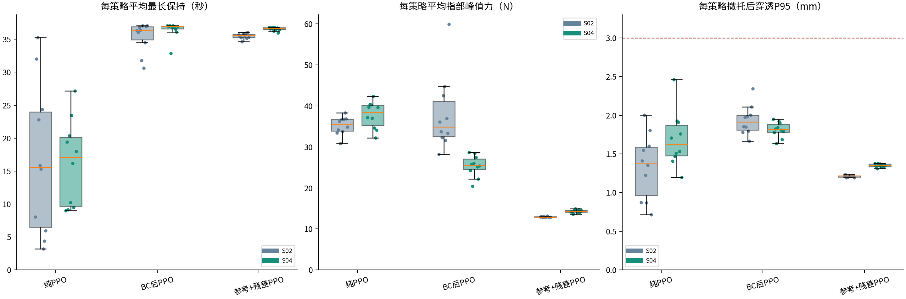

力统计包含成功和失败回合，较早失败可能减少载荷，因而低力不能独立证明安全。它也不是电机额定力矩或所有关节的总载荷。CSV另外保留成功回合条件下的力与分母，可进一步核查。

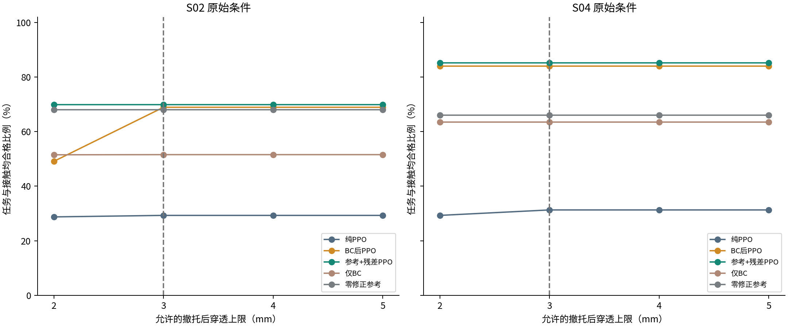

额外检查2/3/4/5mm门槛，是为了了解结论对门槛的依赖；正式评分仍是3mm，不挑最有利的阈值替换。每策略穿透P95表示95%回合的最大穿透不超过该值，不代表所有回合都合格。

### 有残差，是否就证明强抗扰动

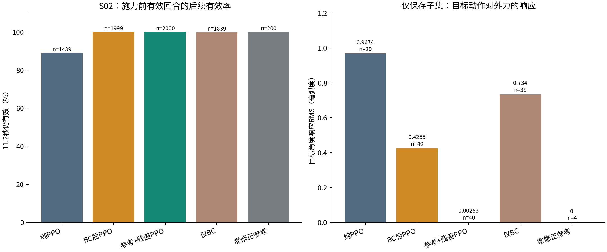

不是。S02推力仅0.15N、持续0.2秒，许多施力前已经抓好的策略都能撑过。右图只来自保存初态的诊断子集，显示目标动作对扰动的变化幅度，不是全体测试成功率。

代码结构已确认是闭环状态输入加执行端残差。但要证明性能提升确实来自“受扰后看状态并纠正”，还要与固定修正回放配对比较。S03这部分完整计划没有全部完成，S04也没有补齐，不能写成机制已经严格证明。

## 16. 最终结论与项目价值

### 已经完成并有证据支持的部分

1. 从既有视频跟踪到Orca关节参考、示范数据、PPO训练及正式评估的工程链路已打通。手型转换和物体匹配不是仅靠文件名对接。
2. BC后PPO与执行端残差PPO都真实实现了，不只是“用视频摆个起手再忽略”。其中只有残差路线在每一步显式保留参考相加。
3. 在匹配来源先验、固定方块任务和163840步在线预算下，两种融合均有明显平均收益；S04预定统计检验支持其相对纯PPO的提升。
4. 消融和物理审查表明，参考质量、仿真校正、训练配方和接触模型都重要；不能只靠一个成功视频描述方法。

### 尚不能声称的部分

- 残差严格优于BC后PPO；任何任务、任意训练预算下均优于PPO。
- 一段视频就能泛化到任意物体、任意摆位，或者新的RGB视频能全自动完成全部环节。
- 提升已被证明主要来自实时抗扰反馈，而不是更合适的固定修正。
- 当前总算力或人工开发成本一定更低；真机部署成功、手指自碰撞或载荷安全已经解决。
- S03所有扩展实验已经完成；不同阶段同一个权重的新初态测试等于全新训练复现。

项目目前最明确的价值是：**将跨手型的视频动作变成可执行先验，并给出两种接入PPO的方式及可追溯的效果与边界。** 可以将物体对齐、参考接口、有界残差、子步物理审查和完整对照作为工程贡献。是否构成新的算法创新，需要再与已有研究逐项对照，不能只因使用“视频+PPO”就宣布算法首创。

## 17. 下一步最值得做什么

| 问题 | 有针对性的下一步 | 怎样才算验证了 |
|---|---|---|
| 参考偏一点就抓不好 | 在物体坐标系动态调整参考，用相同初态比较 | 位置/朝向扰动下降幅度减少，而非只提高常规成绩 |
| 小修正无法适应重物 | 独立扫描残差上限，或让基础抓型依物体属性变化 | 相同预算下质量变化改善，同时无更大穿透或载荷问题 |
| BC长训退化 | 分别试较小学习率、示范正则或混合回放 | 长预算最终检查点不退化；不能只展示中途最好点 |
| 不知道闭环是否有用 | 同初态、同扰动比较实时残差与固定残差回放 | 施力前条件匹配，受扰后成功率出现可靠差异 |
| 来源视频太单一 | 新增真正独立的匹配视频/物体，按视频划分数据 | 留出视频/物体仍可成功，不能用同视频切片代替 |
| 想上真实硬件 | 标定关节顺序、限位、摩擦和力；补状态估计及安全检查 | 小范围低速验证，再逐步扩展，不直接套用仿真目标 |

本次仅完成资料整合与源码注释，没有自动启动这些新训练。

## 18. 术语速查

| 术语 | 用人话解释 |
|---|---|
| 先验/参考 | 训练前已得到的大体动作经验；这里具体是一段关节目标表 |
| 重定向 | 把一个手型能做的动作，转换为另一只手能执行的动作 |
| IK/逆运动学 | 已知指尖想去哪里，反求关节该弯多少 |
| BC/行为克隆 | 给网络示范答案，让它先学会模仿 |
| PPO | 通过自己动作产生的结果和奖励，反复小步改进策略 |
| DAPG | 将示范信息用于策略梯度训练的另一条路线；不是本实验当前主训练方法 |
| 残差 | 加在基础动作上的修正，不是“训练前摆好手型” |
| Actor/Critic | 一个发动作，一个在训练时估计长期收益 |
| 回合/控制步/物理子步 | 一次尝试 / 发一次动作 / 两次动作间更细的物理推进 |
| 种子 | 决定初始化与随机过程的编号；不同训练种子代表重新训练 |
| 消融 | 保持其他部分尽量一致，拆掉一个模块看它的作用 |
| 检查点 | 某个训练步数保存的网络参数，并不自动代表最好模型 |
| 样本效率 | 为学到有用行为需要多少在线交互；不等于总成本 |
| 哈希/SHA256 | 文件内容的指纹，用于检查模型、数据和代码是否被换过 |

## 19. 数据和源码在哪里

- [完整数字附表](all_results.md)：正式条件与消融组的成功率、区间、保持和力。
- [数据说明](data_guide.md)：每份CSV的含义、原始回合、参考NPZ、D01、权重和视频。
- [源码讲解](source_guide.md)：从最重要的四个文件读起，再看全链路。
- [20个带中文注释的源码副本](core_source/README.md)：保留原运行代码，副本只增加注释。
- [全部图表](figures/)：PNG可直接看，PDF用于报告排版。

本报告的整理原则是“叙述合并、证据不混淆”：你可以从头读懂整个实验，也可以顺着文件与统计结果逐项查证。
