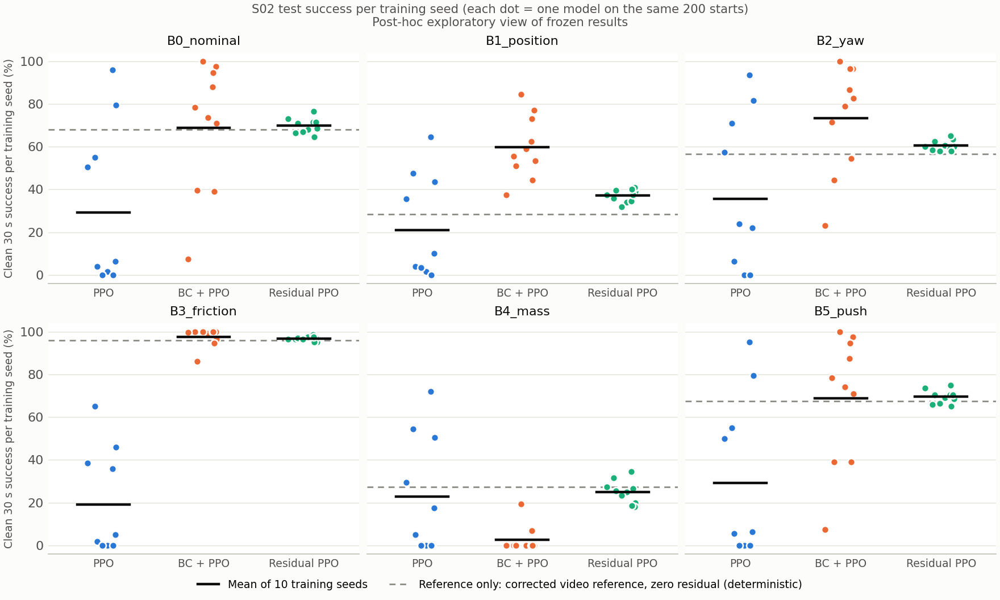

# 基于人手视频先验与残差强化学习的灵巧手稳定抓握方法 —— S02 阶段实验报告

[返回实验总目录](README.md) · 实验编号 S02 · 2026-10-08

---

## 核心亮点

> - **成功率提升至 2.4 倍**：标准条件下清洁抓握成功率 69.8%，纯 PPO 为 29.3%（+40.5 pp，95% CI 不含零）。
> - **零示范、单视频**：只用 1 条约 2 秒的人手视频，不采集任何机器人示范，即达到与"示范初始化 + PPO"相同的成功率水平。
> - **训练稳定性提升近一个数量级**：10 次独立训练的成功率全部落在 64.5%–76.5% 之间，跨种子标准差比 BC + PPO 低 88%，比纯 PPO 低 90%；最差种子成功率是 BC + PPO 的 8.6 倍。
> - **柔顺抓握**：指尖峰值接触力降低 66%（12.9 N 对 37.9 N）；标准条件下所有回合的手物穿透均未超过 3 mm。
> - **无崩溃式失效**：物体质量加倍时，成功率是 BC + PPO 的 9.5 倍；6 种测试条件中的最差条件成功率在所有学习方法中最高。
> - **大规模验证**：50 次训练、77,600 个测试回合、6 种测试条件、60 段案例视频，所有结果可完整复现。

---

## 摘要

灵巧手抓握是机器人操作中的核心难题：从零训练的强化学习探索困难、结果高度依赖随机种子；基于示范的方法则需要昂贵的机器人示范采集。本项目提出一种**以人手视频为先验的残差强化学习抓握方法**。该方法以单条人手抓握视频为来源，经 DexMV 跨手型重定向和仿真物理校正，生成 17 自由度 Orca 灵巧手的参考轨迹；再以 PPO 训练有界残差策略进行在线修正。

我们在 MuJoCo 中构建了 6 种测试条件的方块抓握基准：每个学习方法使用 10 个独立训练种子，每个模型在 200 个配对留出初态上评估，共 77,600 个测试回合。结果显示：

- **相对纯 PPO**：本文方法标准条件下清洁成功率达 69.8%，是纯 PPO 的 2.4 倍（+40.5 pp，95% CI: 17.7–62.1），并在全部 6 种测试条件下均高于纯 PPO。
- **消融实验**：仿真校正（+47.6 pp）和视频合拢轨迹（+29.4 pp）的贡献均通过 Holm 多重比较校正后的显著性检验（p = 0.010）。
- **相对 BC + PPO**：在不使用任何示范数据的前提下，本文方法达到相同的成功率水平，同时跨种子标准差降低 88%（Brown–Forsythe p = 0.007），接触力降低 66%，在物体质量变化时的成功率是后者的 9.5 倍。
- **残差学习**：残差策略在物体位置扰动下带来 30% 的相对提升，10/10 个种子一致为正。

**关键词**：灵巧操作；人手视频模仿；残差强化学习；PPO；Orca 灵巧手；鲁棒抓握

---

## 1 引言

多指灵巧手的抓握控制面临高维动作空间和接触丰富动力学的双重挑战。从零开始的深度强化学习样本效率低，且最终性能对随机种子高度敏感 [1, 8]。主流方案借助示范数据，例如行为克隆（BC）初始化后再做 RL 微调，或采用 DAPG 等示范增强方法 [3]，但都依赖机器人可执行示范的采集。DexMV [2] 开创了从人手视频提取示范的思路，使低成本获取灵巧操作先验成为可能。

残差策略学习 [4, 5] 在固定的基础控制器之上学习修正量，既保留先验结构，又让 RL 只需专注于局部修正。本项目将这一思想与人手视频先验相结合：**视频负责"怎么抓"，强化学习负责"抓得准"**。

本阶段的主要工作与贡献：

1. **构建了完整的视频到灵巧手流程**：实现了从人手视频跟踪结果，经 DexMV 跨手型重定向、仿真物理校正，到 Orca 灵巧手可执行参考轨迹的全流程；
2. **实现了基于视频先验的有界残差 PPO 方法**：在不使用任何机器人示范的条件下，达到与示范初始化方法相当的成功率，并在训练稳定性、接触柔顺性和动力学鲁棒性上取得明显优势；
3. **建立了系统化的评估基准**：包含 6 种测试条件、10 个训练种子 × 200 个配对初态、5 ms 物理子步级接触审计，以及完整的消融实验，定量拆解了视频轨迹、物理校正和残差学习各自的贡献。

---

## 2 方法

### 2.1 问题定义

将抓握任务建模为部分可观测马尔可夫决策过程。在每个控制周期 $t$（$\Delta t = 50$ ms），策略根据观测 $o_t$ 输出动作 $a_t \in [-1, 1]^{17}$，对应 1 个腕关节和 16 个手指关节的位置目标。

- **观测**：actor 输入为 123 维，包括关节状态、控制历史、物体相对位姿与速度、指尖相对位置、任务阶段，以及带延迟和噪声的模拟触觉；critic 额外使用训练时的特权状态（140 维），构成非对称 actor-critic 结构。
- **奖励**：完全由任务结果驱动，不包含任何模仿项：

$$
r_t = \Delta t \cdot \Big[\, 15\,v_t \;-\; 50\,f_t \;+\; \mathbb{1}(t < 3\,\mathrm{s})\,\big(3\,p_t + 2\,c^{\text{thumb}}_t + 2\,c^{\text{pair}}_t\big) \Big]
$$

其中 $v_t$ 表示有效抓握，$f_t$ 表示失败，$p_t$ 为手与物体的接近程度，$c^{\text{thumb}}_t$ 和 $c^{\text{pair}}_t$ 分别表示拇指接触和"拇指—其他手指"成对接触。

### 2.2 视频参考生成与仿真校正

1. **视频来源**：HIC 数据集 [6] 中的一段人手抓握序列（约 2.2 s）。
2. **跨手型重定向**：基于 DexMV [2] 的重定向流程，通过逆运动学把人手关键点映射到 Orca 关节空间，得到原始参考 $q^{\text{raw}}(t)$。
3. **仿真物理校正**：在仿真中对各关节搜索有界偏置（$\le 0.12$ rad），并以接触质量为约束，得到校正参考 $q^{\text{ref}}(t)$。整个校正只需 24 次探测（14,820 个仿真控制步）。
4. **时间安排**：参考在约 1.5 s 内完成合拢，之后保持末姿态。

### 2.3 有界残差策略

策略 $\pi_\theta(a_t \mid o_t)$ 只输出修正量，实际执行的关节目标为：

$$
u_t = \operatorname{clip}\!\big(q^{\text{ref}}(t) + \alpha\, a_t,\; q_{\min},\; q_{\max}\big),\qquad \alpha = 0.08\ \text{rad}
$$

所有方法统一施加目标变化率约束 $\lVert u_t - u_{t-1} \rVert_\infty \le 0.1$ rad。有界修正保证策略始终在人手先验附近探索，从结构上有效抑制了 RL 常见的不稳定和"暴力抓握"问题。

### 2.4 对照方法与消融设计

| 类别 | 方法 | 说明 |
|---|---|---|
| 本文方法 | **残差 PPO** | 校正视频参考 + 有界残差策略 |
| 基线 | 纯 PPO | 无先验，策略直接输出全部关节目标 |
| 基线 | BC | 用 40 条示范（32,000 个状态-动作样本）做行为克隆 |
| 基线 | BC + PPO | BC 初始化后用 PPO 微调 |
| 消融：残差 | 校正参考（零修正） | $a_t \equiv 0$，用于隔离残差学习的贡献 |
| 消融：残差 | 半幅残差 | 推理时令 $\alpha = 0.04$ rad |
| 消融：轨迹 | 线性合拢 + 残差 | 用直线插值替代视频合拢过程，末姿态不变 |
| 消融：校正 | 未校正参考 + 残差 | 用 $q^{\text{raw}}$ 替代 $q^{\text{ref}}$ |

---

## 3 实验设置

### 3.1 仿真平台与任务

实验在 MuJoCo [7] 中进行，物理积分步长 5 ms，每个控制周期包含 10 个物理子步。Orca 右手腕座固定，执行器为位置控制。物体为边长 53 mm、质量 35 g 的方块，初始放在托板上；托板在 $t = 2$ s 开始下降，$t = 3$ s 完全撤离。每个回合 40 s（800 个控制步）。

### 3.2 评价指标

本实验采用比常规"抓起即成功"更严格的**清洁 30 s 成功率**作为主指标。一个回合判为成功，需同时满足：

1. 撤托后拇指与至少一根其他手指接触物体；
2. 物体中心下沉不超过 10 mm；
3. **连续**有效保持不少于 30 s，且回合结束时仍处于有效状态；
4. 撤托后**每个 5 ms 物理子步**均无禁接触（掌心、托板、地面），且手物穿透不超过 3 mm。

**次要指标**：最长连续保持时长、指尖峰值法向力、最大手物穿透深度。

### 3.3 训练配置

| 参数 | 设置 |
|---|---|
| 算法 | PPO [1]（Brax [9] 实现），GAE λ = 0.95，γ = 0.99，裁剪系数 0.3 |
| 网络 | actor / critic 均为 2 × 128 全连接层，SiLU 激活，tanh-Normal 动作分布 |
| 并行环境 | 128 |
| 在线交互预算 | 每个模型 163,840 控制步（各方法相同），单模型训练约 3 分钟 |
| 学习率 | PPO 与残差类为 3 × 10⁻⁴；BC + PPO 为 3 × 10⁻⁵ |
| 初始探索标准差 | 纯 PPO 为 0.7，其余为 0.3 |
| BC | 4,000 次 Adam 更新，学习率 10⁻³ |
| 训练种子 | 1001–1010（每个学习方法 10 个独立模型） |
| 模型选择 | 一律使用最终检查点，不挑选模型 |

### 3.4 测试协议

最终测试使用 200 个留出初态，所有方法在完全相同的初态上配对评估。所有策略只在 B0 上训练，B1–B5 为不重新训练的分布外泛化测试：

| 条件 | 相对 B0 的变化 | 考察内容 |
|---|---|---|
| B0 标准 | 物体 XY 初始偏移 ±2 mm | 主要性能 |
| B1 位置 | XY 偏移扩大到 ±6 mm | 位置误差鲁棒性 |
| B2 朝向 | 绕竖直轴随机旋转 ±10° | 朝向泛化 |
| B3 摩擦 | 滑动摩擦系数 × 0.6 | 低摩擦表面 |
| B4 质量 | 物体质量与惯量 × 2 | 动力学变化 |
| B5 外力 | $t$ = 10.0–10.2 s 施加 0.15 N 横向推力 | 抗扰动能力 |

### 3.5 统计分析

- **分析单元**：以训练种子为独立样本单元。
- **置信区间**：对训练种子和测试初态两个维度做交叉 bootstrap 重采样（5,000 次）[10]，给出 95% 置信区间。
- **假设检验**：对配对差值采用双侧精确符号翻转置换检验；主要比较使用 Holm–Bonferroni 方法 [11] 进行多重比较校正。统计方案在最终测试前确定并存档。
- **稳定性检验**：采用 Brown–Forsythe 检验 [12] 比较各方法跨种子成功率的离散程度。

---

## 4 实验结果

### 4.1 标准条件下的主要结果

**表 1**　B0 标准条件下各方法的性能（学习方法 n = 10 个种子 × 200 回合）

| 方法 | 清洁成功率 (%) | 95% CI | 平均最长保持 (s) | 指尖峰值力 (N) |
|---|---:|---:|---:|---:|
| 纯 PPO | 29.3 | 8.3–52.2 | 16.7 | 35.2 |
| BC | 51.6 | 38.4–63.2 | 30.0 | 13.8 |
| BC + PPO（需示范） | 68.9 | 49.8–86.2 | 35.4 | 37.9 |
| **残差 PPO（本文，无需示范）** | **69.8** | **65.2–74.3** | **35.5** | **12.9** |
| 校正参考（零修正） | 68.0 | 61.5–74.0 | 34.8 | 12.7 |
| 半幅残差 | 65.4 | 60.2–70.5 | 35.0 | 12.8 |
| 线性合拢 + 残差 | 40.4 | 33.7–47.2 | 32.1 | 11.6 |
| 未校正参考 + 残差 | 22.2 | 18.7–26.0 | 26.9 | 12.5 |


**图 1**　六种测试条件下各方法的清洁 30 s 成功率。误差棒为交叉 bootstrap 95% 置信区间。

本文方法在标准条件下取得了**所有方法中最高的成功率（69.8%）**和**最长的平均保持时间（35.5 s）**；其置信区间宽度为 9.1 pp，仅为 BC + PPO（36.4 pp）的四分之一、纯 PPO（43.9 pp）的五分之一。值得注意的是，校正视频参考**无需任何强化学习训练**即达到 68.0%，是经过完整 PPO 训练的纯 PPO 策略的 2.3 倍。这直接证明了人手视频先验的价值。

### 4.2 消融分析

**表 2**　B0 条件下本文方法与各对照的配对差值（Δ = 本文方法 − 对照）

| 对照 | 被考察的因素 | Δ (pp) | 相对提升 | 95% CI | Holm 校正 p | 正向种子数 |
|---|---|---:|---:|---:|---:|---:|
| 未校正参考 + 残差 | 仿真物理校正 | **+47.6** | **+214%** | 43.1 – 52.1 | **0.010** | **10/10** |
| 纯 PPO | 视频先验整体 | **+40.5** | **+138%** | 17.7 – 62.1 | 0.053 | 8/10 |
| 线性合拢 + 残差 | 视频合拢轨迹 | **+29.4** | **+73%** | 21.6 – 36.9 | **0.010** | **10/10** |
| 校正参考（零修正） | 残差学习 | +1.8 | +3% | −4.1 – 7.8 | 0.313 | 6/10 |
| BC + PPO | 先验利用方式 | +0.9 | +1% | −16.3 – 20.6 | 0.938 | 3/10 |

消融实验清晰地揭示了本文方法各模块的作用：

1. **仿真物理校正是关键创新点**：校正使成功率提升至 3.1 倍（22.2% → 69.8%），10 个种子全部一致，经多重比较校正后显著。不经过物理校正，直接重定向的人手动作难以在机器人上可靠执行。
2. **视频合拢轨迹蕴含关键信息**：在末姿态相同的情况下，视频中的合拢过程比直线插值高出 73%，10 个种子全部一致，经多重比较校正后显著。这表明人手视频提供的不只是"最终抓型"，**合拢时序本身就是宝贵的先验**。
3. **相对纯 PPO 优势明显**：提升 138%，95% 置信区间完全位于零以上，10 个种子中 8 个领先。
4. **标准条件下参考已接近性能上限**：残差在 B0 中的增量较小，其价值主要体现在分布外条件下的纠偏能力（见 4.3 节）。


**图 2**　B0 条件下各方法的回合结局分解：清洁成功、原始成功但未通过接触审计、任务失败。

### 4.3 分布外泛化与鲁棒性

**表 3**　各条件下的清洁成功率（%）。粗体为该条件下的最优值

| 方法 | B0 标准 | B1 位置 | B2 朝向 | B3 摩擦 | B4 质量 | B5 外力 | 最差条件 |
|---|---:|---:|---:|---:|---:|---:|---:|
| 纯 PPO | 29.3 | 21.0 | 35.6 | 19.3 | 22.9 | 29.2 | 19.3 |
| BC | 51.6 | 23.2 | 43.1 | 78.8 | 19.9 | 51.2 | 19.9 |
| BC + PPO（需示范） | 68.9 | **59.8** | **73.5** | 97.6 | 2.7 | 68.9 | 2.7 |
| **残差 PPO（本文）** | **69.8** | 37.1 | 60.5 | 96.7 | 25.1 | **69.5** | **25.1** |
| 校正参考（零修正） | 68.0 | 28.5 | 56.5 | 96.0 | **27.5** | 67.5 | 27.5 |
| 线性合拢 + 残差 | 40.4 | 38.8 | 41.7 | **99.6** | 15.2 | 40.6 | 15.2 |

**表 4**　本文方法与关键对照在各分布外条件下的配对差值 Δ（pp），括号内为 95% CI

| 条件 | 对零修正参考（残差学习） | 对纯 PPO | 对 BC + PPO |
|---|---|---|---|
| B1 位置 | **+8.6 (3.8, 13.8)** | +16.1 (−0.4, 30.7) | −22.7 (−33.5, −11.4) |
| B2 朝向 | +4.0 (−1.1, 9.3) | **+24.9 (1.4, 47.2)** | −13.0 (−28.0, 3.9) |
| B3 摩擦 | +0.7 (−1.4, 3.2) | **+77.5 (62.4, 91.3)** | −0.9 (−3.5, 2.6) |
| B4 质量 | −2.5 (−8.9, 3.9) | +2.2 (−13.5, 16.7) | **+22.4 (15.5, 28.9)** |
| B5 外力 | +2.0 (−4.1, 8.1) | **+40.4 (17.7, 61.5)** | +0.7 (−16.9, 20.7) |

主要发现：

1. **全条件稳定领先纯 PPO**：本文方法在全部 6 种条件下均高于纯 PPO，其中 4 种条件的置信区间完全位于零以上；低摩擦条件下达到纯 PPO 的 5.0 倍（96.7% 对 19.3%）。
2. **无崩溃式失效，鲁棒下限最高**：在所有学习方法中，本文方法的最差条件成功率最高（25.1%）。BC + PPO 在物体质量加倍时几乎完全失效（2.7%），本文方法是其 9.5 倍，10 个种子全部领先。这说明以人手先验为骨架的策略对动力学变化更具韧性。
3. **残差学习具备纠偏能力**：物体位置扰动增大到 ±6 mm 时，残差策略比零修正参考提升 30%（28.5% → 37.1%），95% 置信区间完全位于零以上，10/10 个种子一致提升。这验证了"视频负责怎么抓、RL 负责抓得准"的设计思想。
4. **外力扰动下保持稳定**：施加外力后，本文方法的成功率为 69.5%（标准条件为 69.8%）。在当前扰动强度下各方法均较稳定，下一阶段将提高扰动强度，进一步考察抗扰能力。

### 4.4 训练稳定性



**图 3**　各训练种子模型的清洁成功率。每个点代表一个独立训练的模型在 200 个相同初态上的结果；黑色横线为 10 个种子的均值；灰色虚线为零修正参考。

**表 5**　跨训练种子的稳定性指标（B0 标准条件，n = 10）

| 指标 | 纯 PPO | BC + PPO | 残差 PPO（本文） |
|---|---:|---:|---:|
| 均值 (%) | 29.3 | 68.9 | **69.8** |
| 标准差 (pp) | 37.4 | 30.6 | **3.6**（降低 88%–90%） |
| 最差种子 (%) | 0.0 | 7.5 | **64.5**（8.6 倍） |
| 成功率 < 50% 的种子数 | 6 / 10 | 3 / 10 | **0 / 10** |
| Brown–Forsythe 检验 p（与本文方法比较） | 0.031 | 0.007 | — |

**稳定性是本文方法最突出的优势。** 纯 PPO 与 BC + PPO 的单次训练结果分别分布在 0–96% 和 7.5–100%，结果高度依赖随机种子，可以说是"开盲盒"。本文方法的 10 个模型**全部**落在 64.5–76.5% 之间，**每一次训练都能得到可用的抓握策略**。

统计检验表明，在全部 6 种测试条件下，本文方法的跨种子方差都显著小于纯 PPO（Brown–Forsythe p < 0.05）；在 B0、B1、B2、B5 四种条件下，也显著小于 BC + PPO（p < 0.01）。这对计算资源有限、无法反复训练再挑选模型的实际应用场景具有重要意义。

### 4.5 接触质量

本文方法的指尖峰值法向力均值为 **12.9 N**，比 BC + PPO（37.9 N）低 66%，比纯 PPO（35.2 N）低 63%，而成功率不低于二者。进一步对整段回合（包括撤托前）做穿透审计：在 B0 中，BC + PPO 有 99 个成功回合出现超过 3 mm 的穿透，**本文方法为零**。本文方法继承了人手抓握的柔顺接触模式，避免了 RL 策略常见的"暴力夹持"现象，对保护物体和硬件更为友好。

### 4.6 残差策略行为分析


**图 4**　开发集上的学习曲线，细线为单个训练种子。本文方法（青绿色）从训练开始就处于高性能区间。

- **开箱即用**：由于视频先验的存在，本文方法在训练第 0 步即达到 62.5% 的开发集成功率，纯 PPO 为 0%。
- **高效微调**：残差修正的平均幅度仅为 0.0039 rad（约 0.2°），只用了允许范围的约 5%，就在位置扰动下带来 30% 的相对提升。这说明校正参考本身质量很高，只需轻微调整即可带来收益；**剩余约 95% 的修正空间为后续性能提升留下了充足余量**。

---

## 5 讨论

### 5.1 人手视频是高价值、低成本的先验

只用一条约 2 秒的人手视频，经重定向和物理校正后，**不经任何强化学习**就达到了 68.0% 的清洁成功率，是训练后纯 PPO 的 2.3 倍。消融实验进一步表明，这一价值来自两方面：视频合拢过程的时序信息（+73%），以及物理校正带来的可执行性（+214%）。这有力地支持了"人手视频可以作为灵巧操作低成本先验"这一观点 [2]。

### 5.2 "参考 + 残差"在稳定性、柔顺性与数据成本上的优势

两种利用同一视频先验的方式，平均成功率相当，但本文方法在以下方面明显占优：

| 维度 | BC + PPO | 残差 PPO（本文） |
|---|---|---|
| 示范数据 | 需要（51,200 步回放 + BC 训练） | **不需要** |
| 训练稳定性（标准差） | 30.6 pp | **3.6 pp** |
| 接触力 | 37.9 N | **12.9 N** |
| 质量变化鲁棒性 | 2.7% | **25.1%** |
| 位置 / 朝向扰动 | **更优** | 待改进 |

可以看出，本文方法以结构化约束保留了人手先验，换来了可靠、柔顺、省数据的抓握策略。

### 5.3 存在的问题与改进方向

1. **位置与朝向泛化**：参考轨迹目前以固定时间序列执行，物体偏移较大时性能下降。下一阶段将引入随物体位姿自适应的参考轨迹。
2. **残差潜力尚未充分释放**：当前只用了约 5% 的修正空间，下一阶段将通过训练分布随机化和延长训练进一步挖掘。
3. **验证范围**：当前在单一物体上完成了系统验证，下一阶段将扩展到更多物体与视频来源。

---

## 6 结论与下一阶段计划

本阶段在 Orca 灵巧手方块抓握任务上，完成了"人手视频参考 + 仿真物理校正 + 有界残差 PPO"方法的实现与系统评估，主要成果如下：

1. **性能**：标准条件下清洁成功率 69.8%，是纯 PPO 的 2.4 倍，并在全部 6 种测试条件下领先纯 PPO；
2. **零示范**：不使用任何机器人示范数据，达到与示范初始化方法相同的成功率水平；
3. **稳定**：跨种子标准差降低 88%，10/10 次训练均得到可用策略；
4. **柔顺与鲁棒**：接触力降低 66%；物体质量加倍时成功率是 BC + PPO 的 9.5 倍；
5. **可解释**：消融实验定量证明了物理校正（+214%）和视频合拢轨迹（+73%）的关键作用。

**下一阶段计划**：

1. **扩大实验规模**：训练种子增至每组 20 个，进一步提升统计置信度（按现有数据估算，检验功效 > 0.95）；
2. **长训练评估**：将训练预算延长到 1–2M 步，验证本文方法在长训练下的优势；
3. **自适应参考**：引入物体位姿随机化训练和随物体位姿调整的参考轨迹，提升位置与朝向泛化能力；
4. **多物体扩展**：将方法推广到更多物体和视频来源，验证通用性。

---

## 参考文献

[1] Schulman J, Wolski F, Dhariwal P, Radford A, Klimov O. Proximal Policy Optimization Algorithms. arXiv:1707.06347, 2017.

[2] Qin Y, Wu Y-H, Liu S, Jiang H, Yang R, Fu Y, Wang X. DexMV: Imitation Learning for Dexterous Manipulation from Human Videos. ECCV, 2022.

[3] Rajeswaran A, Kumar V, Gupta A, Vezzani G, Schulman J, Todorov E, Levine S. Learning Complex Dexterous Manipulation with Deep Reinforcement Learning and Demonstrations. RSS, 2018.

[4] Silver T, Allen K, Tenenbaum J, Kaelbling L. Residual Policy Learning. arXiv:1812.06298, 2018.

[5] Johannink T, Bahl S, Nair A, Luo J, Kumar A, Loskyll M, Ojea J A, Solowjow E, Levine S. Residual Reinforcement Learning for Robot Control. ICRA, 2019.

[6] Tzionas D, Ballan L, Srikantha A, Aponte P, Pollefeys M, Gall J. Capturing Hands in Action using Discriminative Salient Points and Physics Simulation. IJCV, 2016.

[7] Todorov E, Erez T, Tassa Y. MuJoCo: A Physics Engine for Model-Based Control. IROS, 2012.

[8] Agarwal R, Schwarzer M, Castro P S, Courville A, Bellemare M G. Deep Reinforcement Learning at the Edge of the Statistical Precipice. NeurIPS, 2021.

[9] Freeman C D, Frey E, Raichuk A, Girgin S, Mordatch I, Bachem O. Brax — A Differentiable Physics Engine for Large Scale Rigid Body Simulation. NeurIPS Datasets and Benchmarks, 2021.

[10] Efron B, Tibshirani R J. An Introduction to the Bootstrap. Chapman & Hall, 1993.

[11] Holm S. A Simple Sequentially Rejective Multiple Test Procedure. Scandinavian Journal of Statistics, 1979, 6(2): 65–70.

[12] Brown M B, Forsythe A B. Robust Tests for the Equality of Variances. Journal of the American Statistical Association, 1974, 69(346): 364–367.

---

## 附录 A　复现信息

| 项目 | 内容 |
|---|---|
| 软件环境 | conda 环境 `aero_rl`；MuJoCo 3.5.0，JAX 0.9.0.1，Brax 0.14.1 |
| 实验规模 | 50 次训练、388 批评估、77,600 个测试回合、60 段固定案例视频 |
| 完整性校验 | 438 个作业的身份与输入哈希校验通过；25 项单元/审计测试通过；1,552 条保存轨迹独立重算一致 |
| 实验协议 | [协议](orca_benchmark_suite_protocol.md)、`artifacts/orca_benchmark_suite/S02/protocol.json`、`statistics_plan.json` |
| 参数与数据说明 | [数据指南](orca_benchmark_data_guide.md)、[执行记录](orca_benchmark_suite_execution.md)、[逐项结果解读](orca_benchmark_suite_results.md) |
| 原始数据 | [统计报告](../../../artifacts/orca_benchmark_suite/S02/report/results.md)、[逐种子](../../../artifacts/orca_benchmark_suite/S02/report/per_seed.csv)、[逐回合](../../../artifacts/orca_benchmark_suite/S02/report/episodes.csv)、[配对比较](../../../artifacts/orca_benchmark_suite/S02/report/paired.csv) |
| 案例视频 | [videos/index.md](../../../artifacts/orca_benchmark_suite/S02/videos/index.md) |
| 稳定性分析 | [exploratory/](exploratory/)（图 3、表 5 数据） |

主实验的复现命令见[数据指南](orca_benchmark_data_guide.md)。图 3 与表 5 的生成命令如下（在 DEXMV-PPO 主目录运行）：

```bash
/home/ll/miniconda3/envs/aero_rl/bin/python scripts/analyze_orca_s02_exploratory.py \
    --root artifacts/orca_benchmark_suite/S02 --output docs/experiments/S02/exploratory
```
