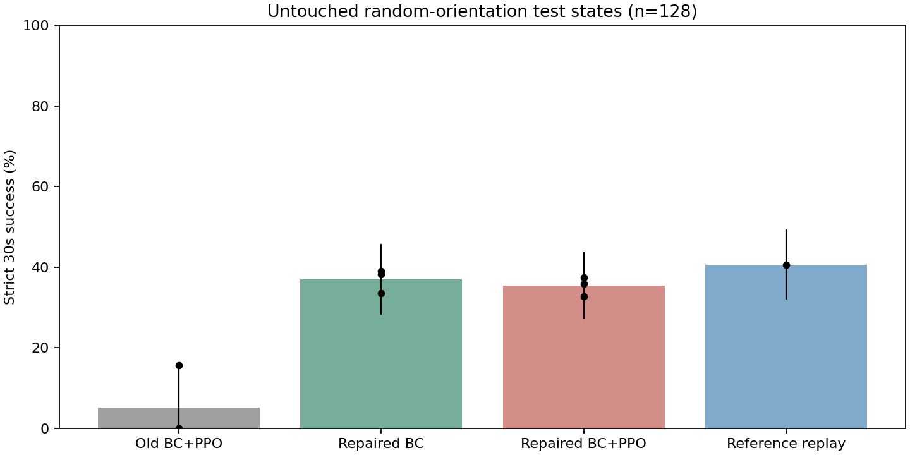

# BC+PPO修复：冻结候选后的保留测试

相同128个随机初态。学习方法各三个训练种子；不是把384次执行当成384个独立训练。
三秒撤除悬吊，随后连续合格抓持30秒并在40秒结束时仍合格。失败不筛除。

| 方法 | 成功率 | 各训练种子 | 成功/执行 | 描述性95%区间 |
|---|---:|---|---:|---|
| Old BC+PPO | 5.21% | 0.00% / 15.62% / 0.00% | 20/384 | 0.00%--15.62% |
| Repaired BC | 36.98% | 33.59% / 38.28% / 39.06% | 142/384 | 28.39%--45.57% |
| Repaired BC+PPO | 35.42% | 37.50% / 32.81% / 35.94% | 136/384 | 27.34%--43.50% |
| Reference replay | 40.62% | 40.62% | 52/128 | 32.03%--49.22% |

## 配对初态上的差值

- new_bc_ppo minus old_bc_ppo：+30.21个百分点；描述性区间 +17.19 至 +41.67 个百分点。
- new_bc_ppo minus new_bc：-1.56个百分点；描述性区间 -7.81 至 +5.21 个百分点。
- new_bc_ppo minus reference：-5.21个百分点；描述性区间 -12.50 至 +1.82 个百分点。

## 不能混淆的事

- 旧4.17%来自旧测试集；本表旧权重也在新128例上重新评估，以本表为直接比较。
- 修复同时增加了初始朝向模式条件、BC输入课程和BC更新量，并降低探索幅度；不是单变量最终比较，也不是等总调参成本。
- 修复仍是单网络完整目标控制。PPO阶段全部实时观测和权重可训练，无参考动作加法。
- 新BC与接续PPO按相同训练种子配对；旧/新训练种子独立重采样，测试初态始终配对。
- 区间是描述性bootstrap，仅三个训练种子，不作强显著性或所有朝向成功的保证。
- 成功条件约束穿透，但未限定峰值接触力；仿真成功不等于可直接上硬件。
- 本轮没有从新RGB视频重新提取。使用原处理后DexMV示范，专门隔离训练算法问题。

原始数据：episodes.csv；配对得失：bc_to_ppo_transitions.csv；完整统计：statistics.json。
