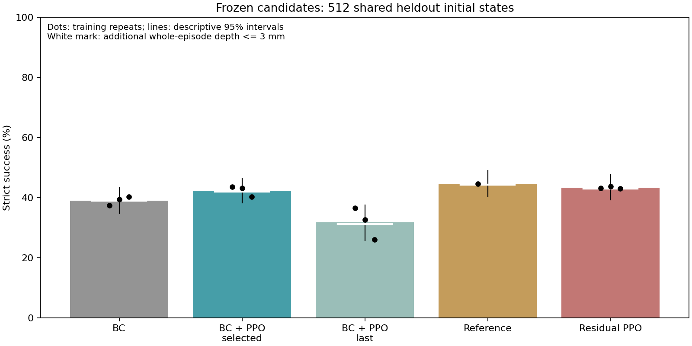
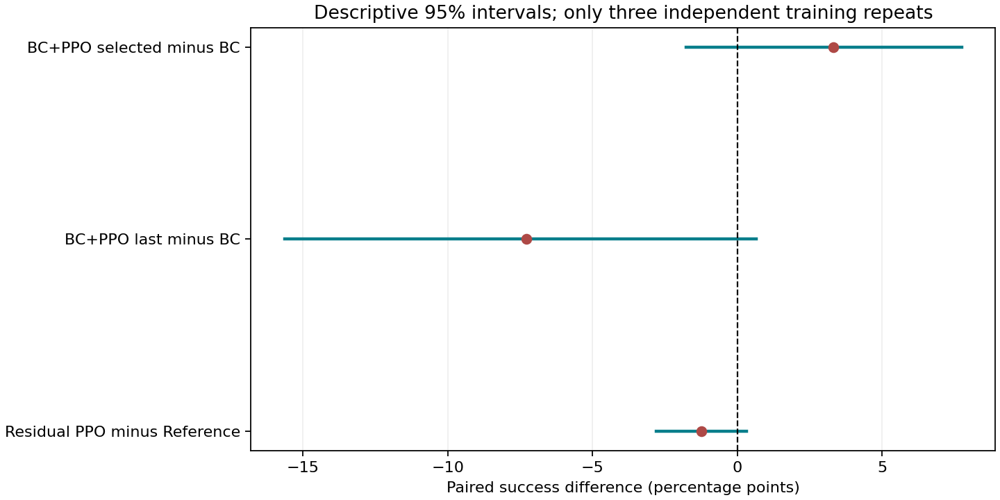

# S09 PPO增益：独立保留测试

任务：固定Orca手抓随机朝向圆柱；初始悬吊3秒后撤除支撑，连续合格抓持至少30秒，40秒结束时仍合格。物体中心只有毫米级扰动，不是任意空间位置抓取。

权重只依据开发集挑选并预先冻结；以下512个初态不参与调参。BC与接续PPO用同一BC起点配对，残差与同一参考回放配对。

| 方法 | 成功/执行 | 成功率 | 各训练重复成功率 | 最长合格抓持均值(s) |
|---|---:|---:|---|---:|
| 仅BC | 599/1536 | 39.00% | 37.30% / 39.45% / 40.23% | 17.565 |
| BC＋PPO（开发集选定） | 650/1536 | 42.32% | 43.55% / 43.16% / 40.23% | 18.499 |
| BC＋PPO（训练末步） | 487/1536 | 31.71% | 36.52% / 32.62% / 25.98% | 15.067 |
| 零修正参考回放 | 228/512 | 44.53% | 44.53% | 21.774 |
| 参考＋残差PPO | 665/1536 | 43.29% | 43.16% / 43.75% / 42.97% | 20.768 |

## PPO到底有没有贡献

- BC＋PPO（开发集选定）相对仅BC：+3.32个百分点，描述性95%区间[-1.76, +7.75]。本次平均值提高，但区间跨0，尚不能据此认定稳定提高。
- BC＋PPO（训练末步）相对仅BC：-7.29个百分点，描述性95%区间[-15.62, +0.65]。本次没有得到平均提升，不能宣称PPO改进成功。
- 参考＋残差PPO相对零修正参考回放：-1.24个百分点，描述性95%区间[-2.80, +0.33]。本次没有得到平均提升，不能宣称PPO改进成功。

## 接触质量

| 方法 | 释放后最大穿透(mm) | 释放前最大穿透(mm) | 全部案例峰值力(N) | 全回合穿透限制下的次级成功率 |
|---|---:|---:|---:|---:|
| 仅BC | 17.625 | 14.991 | 233.73 | 39.00% |
| BC＋PPO（开发集选定） | 11.550 | 9.421 | 55.80 | 41.99% |
| BC＋PPO（训练末步） | 9.641 | 11.894 | 66.05 | 31.18% |
| 零修正参考回放 | 18.394 | 18.579 | 186.55 | 44.34% |
| 参考＋残差PPO | 23.733 | 19.027 | 197.23 | 42.97% |

## 失败不只有掉落

| 方法 | 3秒内终止的失败执行 | 存活满40秒但不达标的执行 | 门控重建不一致帧 |
|---|---:|---:|---:|
| 仅BC | 5 | 197 | 0 |
| BC＋PPO（开发集选定） | 10 | 151 | 0 |
| BC＋PPO（训练末步） | 10 | 141 | 0 |
| 零修正参考回放 | 5 | 54 | 0 |
| 参考＋残差PPO | 33 | 145 | 0 |

failure_gates.csv逐项列出失败执行中的载荷不足、高度损失、穿透等现象及持续时间。原因可同时出现，不能相加当失败总数，也不能仅凭相关计数判定因果。三个模型共用512初态，表中次数是模型与初态的执行对数。浮点边界的重建差异单列，不改写原标签。

## 怎样理解

- 参考回放组使用同一残差控制接口并固定修正为精确0，避免归一化往返的浮点差异；不是一个训练后的残差策略。
- BC是模仿示范学出完整关节目标；BC+PPO继续通过环境奖励修改这个网络，执行时没有参考动作相加。
- BC+PPO分别列开发集选定的检查点与同三次训练的真正末步；后者检查长训是否退化，不是新增三次独立训练。不能看保留成绩再在两行之间选优，或用中途模型的提高宣称末步也提高。
- 残差执行时为关节目标=参考动作+有界PPO修正；学习修正的实际大小在statistics.json中记录，不能把零修正回放当作残差改进。
- requested是网络请求的修正；effective_target是关节限幅后控制目标相对参考的偏移，不是手指真实转动量。两者都只统计实际执行帧，不能将结束后的补齐帧当动作。完整动作BC策略没有这项加法，其残差字段按约定为0。
- 初始圆柱方向从SO(3)均匀采样；六模式只是选择参考的分类，不是仅测试六个固定角度，也不是所有方向都成功。
- 1536次模型-初态执行包含三个模型重复使用同512个初态，不是1536个独立训练。区间用配对初态重采样，训练重复仍较少。
- 数据中training_seed表示PPO训练起点的独立重复编号；对应BC行沿用这个编号方便配对，BC实际预训练种子另列bc_pretraining_seed。逐例seed才是评估初态种子，参考组编号0不表示训练过一次。
- 路径训练量与全部调参搜索花费不同；plan.json记录所选路径，开发日志保留失败。此表不是与纯PPO等总预算比较。
- 本轮没有重新从新RGB视频提取；使用已有处理后DexMV示范及校正参考，隔离训练优化问题。
- 原判据只限制释放后的累计穿透；全回合穿透限制是另报的次级指标。未限制峰值力，因此仿真成功不意味着可直接上硬件。
- 原始逐例数据在episodes.csv及保留嵌套诊断结构的episodes.json，配对新增/丢失在paired_transitions.csv，模式分层在orientation_modes.csv，失败门控在failure_gates.csv。权重与执行哈希见上一级plan.json。
