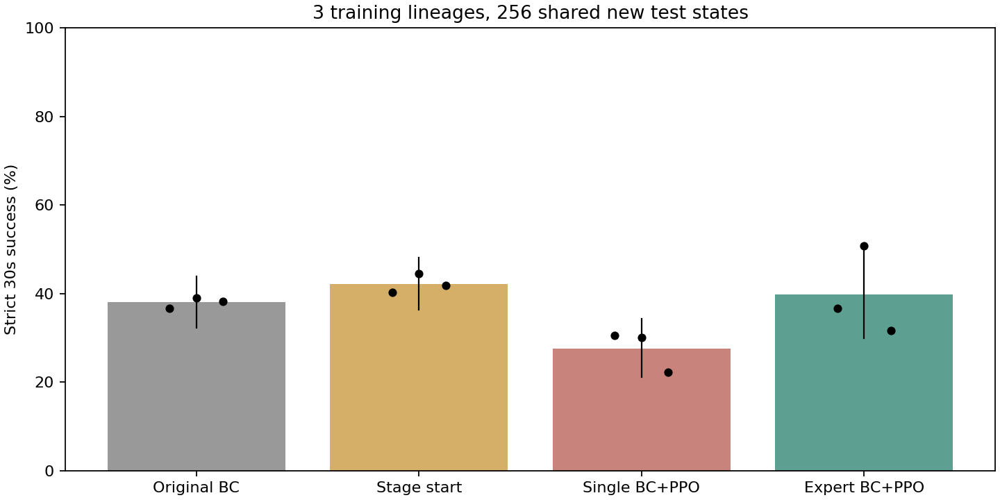

# 专家BC+PPO：三个来源的新初态确认

三个来源、同256个未用于本轮调参的新初态，四组全部按预定路径报告。每组768策略-初态对，不是768个训练种子。
专家和单网络均报告真正末步，原BC为0在线步，阶段起点655360步，两个末步均累计1310720步。

| 方法 | 总成功率 | 三来源分别 | 成功/策略-初态对 | 描述性95%区间 |
|---|---:|---|---:|---|
| Original BC | 38.02% | 36.72% / 39.06% / 38.28% | 292/768 | [32.29%, 43.88%] |
| Stage start | 42.19% | 40.23% / 44.53% / 41.80% | 324/768 | [36.32%, 48.18%] |
| Single BC+PPO | 27.60% | 30.47% / 30.08% / 22.27% | 212/768 | [21.09%, 34.24%] |
| Expert BC+PPO | 39.71% | 36.72% / 50.78% / 31.64% | 305/768 | [29.95%, 50.78%] |

## 配对差值

- expert_last minus bc：+1.69个百分点，描述性95%区间[-8.59, +11.98]。
- expert_last minus stage：-2.47个百分点，描述性95%区间[-11.33, +6.51]。
- expert_last minus single_last：+12.11个百分点，描述性95%区间[+4.56, +21.09]。

## 证据边界

- 三个来源的BC、阶段起点、单网络与专家按祖先配对。图中黑点是三个来源，不是回合重复。
- 来源与初态共同重采样，来源只有三个，区间不能证明所有训练种子都有效。
- 专家actor为六倍参数量；同在线步数不是同计算量或同调参总成本。
- 未更换视频、物理或成功判据；当前实验不回答残差是否优于其参考基础。
- 主成功要求释放后穿透不超过3mm；全回合3mm附加结果、失败原因及峰值力另列models.csv和failure_gates.csv。
- 保存预览均原批次重现并独立物理核验，不声称全部未保存执行都另做回放，更不等于实机安全验证。
- 此区间从现在起已消耗，不再用于下一轮调参后的独立确认。

原始逐例episodes.csv，来源汇总models.csv，配对得失paired_successes.csv，完整统计及哈希statistics.json。
