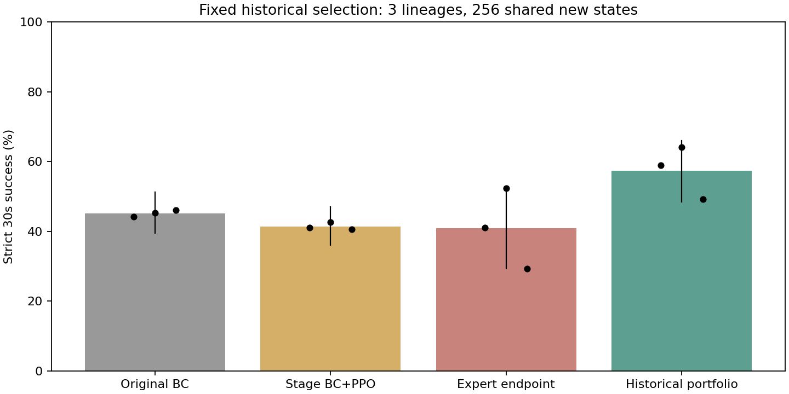

# 历史组合：三个来源的新初态确认

只用旧开发集固定选取各朝向的BC/阶段/专家末步actor，再评估200000--200255。未按本测试重选。
每组768策略-初态对，只有三个训练来源和256个唯一初态；组合新增0步PPO，继承1310720步，actor六倍容量。

| 方法 | 平均成功率 | 三来源分别 | 成功/执行 | 描述性95%区间 |
|---|---:|---|---:|---|
| Original BC | 45.18% | 44.14% / 45.31% / 46.09% | 347/768 | [39.45%, 51.17%] |
| Stage BC+PPO | 41.41% | 41.02% / 42.58% / 40.62% | 318/768 | [36.07%, 47.01%] |
| Expert endpoint | 40.89% | 41.02% / 52.34% / 29.30% | 314/768 | [29.30%, 52.60%] |
| Historical portfolio | 57.42% | 58.98% / 64.06% / 49.22% | 441/768 | [48.44%, 66.02%] |

## 配对差值

- portfolio minus bc：+12.24个百分点，描述性95%区间[+2.73, +20.44]。
- portfolio minus stage：+16.02个百分点，描述性95%区间[+8.98, +23.44]。
- portfolio minus expert_last：+16.54个百分点，描述性95%区间[+10.94, +22.53]。

## 限制

- 这是固定历史组合规则的重复验证，不是新训练算法，也不是执行级残差。不能用它覆盖专家末步确认的负结果。
- 只有三个来源；区间不是所有初始化有效的保证，额外开发选择和六倍actor成本必须计入。
- 阶段起点也是BC+PPO，累计655360步；专家和组合继承1310720步。只有专家与组合路径预算相同。
- 成功仍按释放后3mm等原严格判据；全回合3mm、失败载荷和穿透另见models.csv，不声称硬件安全。
- 所有保存预览均原批次重现并独立物理核验，不声称全部未保存回合都另做回放。
- 此测试区间已消耗，不能用于下一次改法的独立确认。

逐例episodes.csv，分朝向orientation.csv，配对得失paired_successes.csv，接触models.csv，证据statistics.json。
