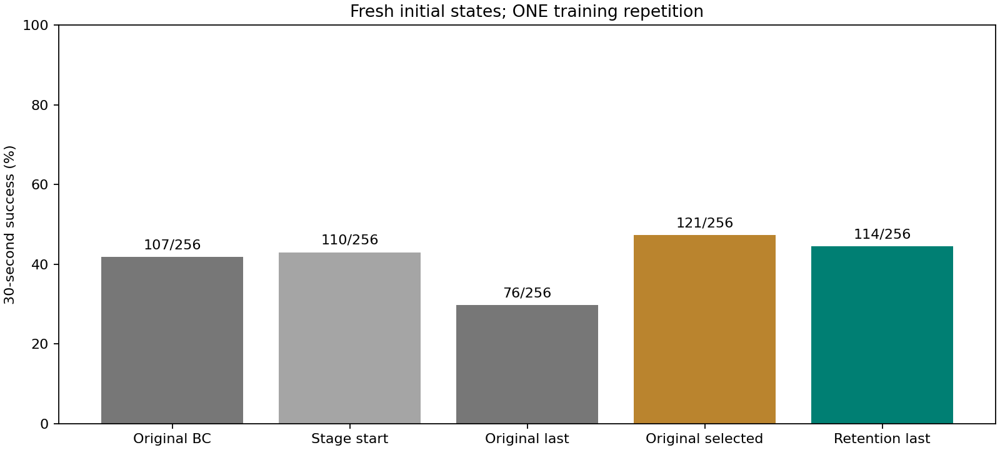

# 长阶段保持约束：固定候选后的新初态检查

五组均在160000--160255同256初态评估，全部1280次执行保留，权重在使用这些初态之前已冻结。本轮只有一个训练重复，不是五次独立训练，也不能替代三种子稳定性验证。

| 策略 | 成功/256 | 成功率 | 最长合格时长均值(s) |
|---|---:|---:|---:|
| 原始BC | 107/256 | 41.80% | 18.698 |
| 本阶段起点 | 110/256 | 42.97% | 18.626 |
| 原配方真正末步 | 76/256 | 29.69% | 15.265 |
| 原配方预选模型 | 121/256 | 47.27% | 20.230 |
| 保持约束真正末步 | 114/256 | 44.53% | 20.843 |

## 相同初态上的新增与丢失

以下始终是保持约束末步减去对应对照，不能根据测试结果再换本轮检查点。

| 对照 | 新增成功 | 丢失成功 | 差值(pp) | 描述性95%区间(pp) |
|---|---:|---:|---:|---:|
| 原始BC | 27 | 20 | +2.73 | [-2.73, +8.20] |
| 本阶段起点 | 10 | 6 | +1.56 | [-1.56, +4.69] |
| 原配方真正末步 | 71 | 33 | +14.84 | [+7.42, +22.66] |
| 原配方预选模型 | 32 | 39 | -2.73 | [-9.38, +3.91] |

区间仅重采样初态，未覆盖训练随机性，四项比较没有多重校正。经验区间退化成单点也不表示真实差值已确定；不作算法普遍优越性宣称。

## 接触与审核

| 策略 | 全部案例释放后最大穿透(mm) | 释放前最大穿透(mm) | 峰值力(N) | 全回合3mm次级成功率 |
|---|---:|---:|---:|---:|
| 原始BC | 2.904 | 6.991 | 59.416 | 41.80% |
| 本阶段起点 | 6.618 | 9.316 | 223.713 | 42.58% |
| 原配方真正末步 | 6.607 | 13.396 | 151.368 | 28.52% |
| 原配方预选模型 | 7.482 | 19.179 | 205.551 | 46.88% |
| 保持约束真正末步 | 6.986 | 9.065 | 53.403 | 44.14% |

全部案例门控重建差异帧合计0；20条保存预览通过权重绑定与独立物理回放，不冒充所有1280条轨迹均独立重放。失败的高穿透和高力不删除；仿真成功不是硬件安全证明。

源码记录限制：冻结清单包含96项，但未单列12项共用依赖。汇总时另核对了这些依赖在五组原训练配置、原训练源码快照、此次评估源码快照与当前文件中的哈希，全部一致；补充证据写入statistics.json。此项是事后完整性核对，不冒充事先冻结全部依赖，未改原计划、评分或任何评估轨迹。

原BC尚未在线强化学习；阶段起点已经累计655360次交互；两种末步路径总量均1310720。原配方预选模型是旧开发阶段已固定的E46/327680，不是本次看测试结果新挑选，所选权重路径983040但原实验完整训练预算仍1310720。相同在线预算不等于全部搜索成本相同。

所有策略都是同一17维完整目标网络。保持约束的教师只参与训练，不是执行时BC动作加PPO修正，也不是残差架构。本轮没有更换视频、手型、摩擦或成功条件。

逐例数据见episodes.csv，配对得失见paired.csv，各朝向见orientation.csv，固定权重和来源见../plan.json。E76类别均衡BC接PPO是另一个开发分支，未插入本次五组。
