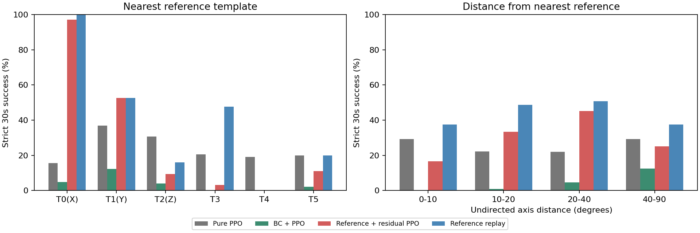

# S09参考朝向覆盖分析

仅分析预先冻结的128个连续随机初态，不增加或删除测试。每个初态计算到6个参考模板的最近无向轴夹角；圆柱首尾翻转与绕自身轴转动视为等价。
分箱只用于事后诊断，不是训练课程，也没有给纯PPO/BC后PPO偷偷输入参考。表中学习组按3个训练种子平均，同一初态不会被说成3个不同朝向。

| 分组 | 编号 | 方法 | 不同初态数 | 评估次数 | 成功率 |
|---|---|---|---:|---:|---:|
| template | 0 | Pure PPO | 34 | 102 | 15.69% |
| template | 1 | Pure PPO | 19 | 57 | 36.84% |
| template | 2 | Pure PPO | 25 | 75 | 30.67% |
| template | 3 | Pure PPO | 21 | 63 | 20.63% |
| template | 4 | Pure PPO | 14 | 42 | 19.05% |
| template | 5 | Pure PPO | 15 | 45 | 20.00% |
| angle_bin | 0 | Pure PPO | 8 | 24 | 29.17% |
| angle_bin | 1 | Pure PPO | 39 | 117 | 22.22% |
| angle_bin | 2 | Pure PPO | 65 | 195 | 22.05% |
| angle_bin | 3 | Pure PPO | 16 | 48 | 29.17% |
| template | 0 | BC + PPO | 34 | 102 | 4.90% |
| template | 1 | BC + PPO | 19 | 57 | 12.28% |
| template | 2 | BC + PPO | 25 | 75 | 4.00% |
| template | 3 | BC + PPO | 21 | 63 | 0.00% |
| template | 4 | BC + PPO | 14 | 42 | 0.00% |
| template | 5 | BC + PPO | 15 | 45 | 2.22% |
| angle_bin | 0 | BC + PPO | 8 | 24 | 0.00% |
| angle_bin | 1 | BC + PPO | 39 | 117 | 0.85% |
| angle_bin | 2 | BC + PPO | 65 | 195 | 4.62% |
| angle_bin | 3 | BC + PPO | 16 | 48 | 12.50% |
| template | 0 | Reference + residual PPO | 34 | 102 | 97.06% |
| template | 1 | Reference + residual PPO | 19 | 57 | 52.63% |
| template | 2 | Reference + residual PPO | 25 | 75 | 9.33% |
| template | 3 | Reference + residual PPO | 21 | 63 | 3.17% |
| template | 4 | Reference + residual PPO | 14 | 42 | 0.00% |
| template | 5 | Reference + residual PPO | 15 | 45 | 11.11% |
| angle_bin | 0 | Reference + residual PPO | 8 | 24 | 16.67% |
| angle_bin | 1 | Reference + residual PPO | 39 | 117 | 33.33% |
| angle_bin | 2 | Reference + residual PPO | 65 | 195 | 45.13% |
| angle_bin | 3 | Reference + residual PPO | 16 | 48 | 25.00% |
| template | 0 | Reference replay | 34 | 34 | 100.00% |
| template | 1 | Reference replay | 19 | 19 | 52.63% |
| template | 2 | Reference replay | 25 | 25 | 16.00% |
| template | 3 | Reference replay | 21 | 21 | 47.62% |
| template | 4 | Reference replay | 14 | 14 | 0.00% |
| template | 5 | Reference replay | 15 | 15 | 20.00% |
| angle_bin | 0 | Reference replay | 8 | 8 | 37.50% |
| angle_bin | 1 | Reference replay | 39 | 39 | 48.72% |
| angle_bin | 2 | Reference replay | 65 | 65 | 50.77% |
| angle_bin | 3 | Reference replay | 16 | 16 | 37.50% |

template=0/1/2对应X/Y/Z开发模板，3/4/5是三个随机开发模板；angle_bin=0/1/2/3分别对应[0,10)、[10,20)、[20,40)、[40,90]度。
即使角度近也可能因为位置、指腹接触、物体旋转或局部几何失败；夹角与成功率的相关性不是因果证明。某些箱的初态很少，不能强推显著性。
本分析不能证明增加模板一定解决问题，只用于定位应优先检查的方向。所有失败模板仍保留在参考库，未因成绩差而排除。
