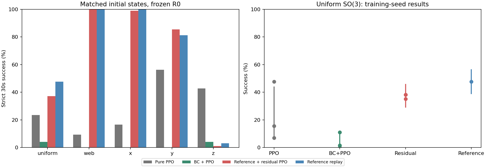
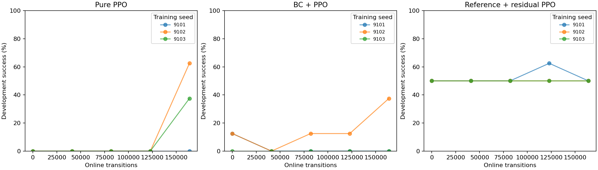

# S09固定奖励四组实验结果

本报告由完整50项评估、2560个回合生成，缺项时脚本会拒绝发布。
三种学习方法各3个训练种子，每次163840步；参考没有训练种子。以下不是把每个回合当作独立训练。

## 结果

| 朝向 | 方法 | 平均成功率 | 各训练种子成功率 |
|---|---|---:|---|
| uniform | 纯PPO | 23.44% | 7.03% / 47.66% / 15.62% |
| uniform | BC后PPO | 4.17% | 0.00% / 10.94% / 1.56% |
| uniform | 参考＋残差PPO | 37.24% | 35.16% / 38.28% / 38.28% |
| uniform | 参考回放 | 47.66% | 47.66% |
| web | 纯PPO | 9.38% | 6.25% / 0.00% / 21.88% |
| web | BC后PPO | 0.00% | 0.00% / 0.00% / 0.00% |
| web | 参考＋残差PPO | 100.00% | 100.00% / 100.00% / 100.00% |
| web | 参考回放 | 100.00% | 100.00% |
| x | 纯PPO | 16.67% | 21.88% / 0.00% / 28.12% |
| x | BC后PPO | 0.00% | 0.00% / 0.00% / 0.00% |
| x | 参考＋残差PPO | 98.96% | 96.88% / 100.00% / 100.00% |
| x | 参考回放 | 100.00% | 100.00% |
| y | 纯PPO | 56.25% | 46.88% / 96.88% / 25.00% |
| y | BC后PPO | 0.00% | 0.00% / 0.00% / 0.00% |
| y | 参考＋残差PPO | 85.42% | 87.50% / 78.12% / 90.62% |
| y | 参考回放 | 81.25% | 81.25% |
| z | 纯PPO | 42.71% | 0.00% / 100.00% / 28.12% |
| z | BC后PPO | 4.17% | 12.50% / 0.00% / 0.00% |
| z | 参考＋残差PPO | 1.04% | 0.00% / 3.12% / 0.00% |
| z | 参考回放 | 3.12% | 3.12% |

## 学习过程

这些曲线仅用8个固定开发初态，不能代替最终测试。BC后PPO的0步是BC完成后的起点；残差的0步已经有视频参考，不是从零动作开始。
监测elapsed_sec不含BC预训练；离线校正与采集另外统计，不能只用PPO步数比较全部成本。

## 结果边界

仅有3个学习种子，区间为描述性分层bootstrap，不作强显著性宣称。参考组区间只反映测试初态抽样，不能解释为训练随机性。
若某组样本全成功/全失败，经验bootstrap区间可能退化成单点；这不代表真实成功概率已确定为100%或0%，不能外推为未来必然成功/失败。
圆柱朝向覆盖完整SO(3)采样域，不表示每个方向都抓得到。物体位置限于固定手的可达区域；悬吊为通过质心的理想平衡吊带，不是端部绑绳或真实柔性绳接触模型。
示范是已有DexMV处理后指尖轨迹经IK与仿真校正生成，不是新拍摄的多视角视频；只选成功回合作BC数据，但全部参考尝试和全部测试失败均保留。
相同在线步数不等于总成本相同。IK、物理参考校正、示范采集与BC有额外开销。部分失败存在过大穿透和力峰值，不能直接视为硬件可部署。
本表固定奖励版本R0，不混入之后的奖励调参。主指标要求最后仍合格；中途拿住30秒后掉落不能算成功。

- [逐回合原始数据](episodes.csv)
- [分层统计与描述性区间](summary.json)
- [配对成功率差值](paired_differences.json)
- [逐种子学习曲线数据](learning_curves.csv)
- [额外离线计算量](offline_cost.json)
