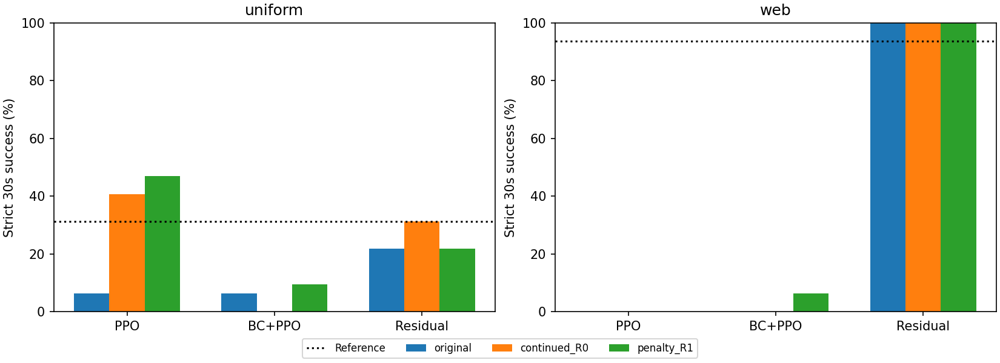

# S09奖励迭代：单种子探索性结果

固定R0比较完成后，三种学习方法各从seed9101末步出发。两个续训分支都增加40960步、同样重置优化器、使用相同新种子10101，区别只在穿透惩罚。
原R0=163840步；同奖励续训/R1=累计204800步。因此应比较两种续训分支来判断惩罚作用，不能把全部增益解释为奖励改善。
新保留初态：随机朝向32个、虎口方向16个，总计480回合；只有一个续训种子，不能替代主实验的3种子统计。

| 朝向 | 方法 | 版本 | 成功/次数 | 成功率 | 平均最长保持(s) | 最大穿透(mm) |
|---|---|---|---:|---:|---:|---:|
| uniform | 纯PPO | original | 2/32 | 6.25% | 5.63 | 4.080 |
| uniform | 纯PPO | continued_R0 | 13/32 | 40.62% | 17.89 | 4.080 |
| uniform | 纯PPO | penalty_R1 | 15/32 | 46.88% | 21.09 | 6.297 |
| uniform | BC后PPO | original | 2/32 | 6.25% | 3.41 | 3.486 |
| uniform | BC后PPO | continued_R0 | 0/32 | 0.00% | 0.00 | 4.558 |
| uniform | BC后PPO | penalty_R1 | 3/32 | 9.38% | 3.47 | 2.726 |
| uniform | 参考＋残差PPO | original | 7/32 | 21.88% | 14.21 | 11.502 |
| uniform | 参考＋残差PPO | continued_R0 | 10/32 | 31.25% | 15.85 | 2.646 |
| uniform | 参考＋残差PPO | penalty_R1 | 7/32 | 21.88% | 14.37 | 1.591 |
| uniform | 参考回放 | original | 10/32 | 31.25% | 17.47 | 1.581 |
| web | 纯PPO | original | 0/16 | 0.00% | 7.21 | 7.482 |
| web | 纯PPO | continued_R0 | 0/16 | 0.00% | 2.24 | 8.681 |
| web | 纯PPO | penalty_R1 | 0/16 | 0.00% | 4.22 | 2.940 |
| web | BC后PPO | original | 0/16 | 0.00% | 0.00 | 4.448 |
| web | BC后PPO | continued_R0 | 0/16 | 0.00% | 0.00 | 3.375 |
| web | BC后PPO | penalty_R1 | 1/16 | 6.25% | 2.31 | 2.671 |
| web | 参考＋残差PPO | original | 16/16 | 100.00% | 37.00 | 1.185 |
| web | 参考＋残差PPO | continued_R0 | 16/16 | 100.00% | 37.00 | 1.215 |
| web | 参考＋残差PPO | penalty_R1 | 16/16 | 100.00% | 37.00 | 1.225 |
| web | 参考回放 | original | 15/16 | 93.75% | 36.63 | 1.030 |

## 开发集选择的候选

候选选择只看开发集末步：成功率优先，再比较穿透、保持时长、少训练优先。没有根据本页测试成绩选模型。
这里的候选仅限seed9101原模型与其续训分支，不是从全工程全部种子中寻找最优权重；原R0另外两个种子仍保留。
- 纯PPO：penalty_R1；开发成功率50.00%；权重位于主工程`artifacts/orca_benchmark_suite/S09/reward_iteration/train/penalty_R1_ppo/step_000040960/params.pkl`。
- BC后PPO：penalty_R1；开发成功率0.00%；权重位于主工程`artifacts/orca_benchmark_suite/S09/reward_iteration/train/penalty_R1_guided/step_000040960/params.pkl`。
- 参考＋残差PPO：original；开发成功率50.00%；权重位于主工程`artifacts/orca_benchmark_suite/S09/train/residual_s9101/step_000163840/params.pkl`。

参考回放没有PPO奖励，不做续训；它仍在新保留初态上评估。
惩罚既可能改善接触，也可能让手不敢收拢；若成功率下降，不应只拿力峰值下降声称策略改善。候选权重不是硬件安全或全方向成功的保证。
所有20项评估保存的预览均通过原生回放核验；未声称全部480条轨迹独立重放。配对区间仅反映测试初态抽样，不能估计训练随机性。

- [原始逐回合数据](episodes.csv)
- [续训first/last/max/best_step](training.json)
- [相同追加步数的配对差值](paired_differences.json)
- [候选策略及依赖清单](candidate_policies.json)
