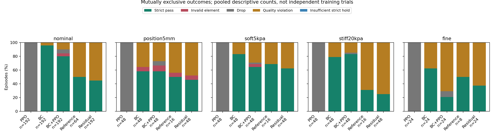

# S12 失败原因分解

来自完整保存轨迹，不重新运行或改变成功门槛。
违规按撤台完成后（5.5 秒起）计算；整个回合的峰值可能发生在撤台前，不能直接据此判定严格失败。
违规持续数量是含至少一个违规物理子步的 50 ms 控制区间数，不等于接触精确持续时长。
掉落、单元塌陷和质量违规可以同时发生，各列不可直接相加。体积比小于等于 0.05 会终止回合；非正值表示单元翻转，属于无效材料/数值状态，不能解释为真实物体已被捏碎。原始 alive=false 同时包含掉落与塌陷，不能只据它统计掉落。
每种方法的多个训练种子这里只作描述性计数，不当成独立训练样本做显著性检验。

| 条件 | 方法 | 回合数 | 严格通过 | 物理保持 | 掉落 | 单元塌陷 | 其中翻转 | 曾质量违规 | 未掉落但质量违规 | 未掉落但保持不足 |
|---|---|---:|---:|---:|---:|---:|---:|---:|---:|---:|
| nominal | ppo | 192 | 0 | 0 | 192 | 0 | 0 | 0 | 0 | 0 |
| nominal | guided | 192 | 154 | 170 | 11 | 8 | 4 | 30 | 19 | 0 |
| nominal | bc_initial | 192 | 184 | 192 | 0 | 0 | 0 | 8 | 8 | 0 |
| nominal | residual | 192 | 86 | 192 | 0 | 0 | 0 | 106 | 106 | 0 |
| nominal | reference | 64 | 32 | 64 | 0 | 0 | 0 | 32 | 32 | 0 |
| position5mm | ppo | 48 | 0 | 0 | 48 | 0 | 0 | 0 | 0 | 0 |
| position5mm | guided | 48 | 28 | 40 | 3 | 4 | 2 | 15 | 13 | 0 |
| position5mm | bc_initial | 48 | 28 | 45 | 0 | 3 | 2 | 17 | 17 | 0 |
| position5mm | residual | 48 | 22 | 45 | 0 | 3 | 2 | 23 | 23 | 0 |
| position5mm | reference | 16 | 8 | 15 | 0 | 1 | 1 | 7 | 7 | 0 |
| soft5kpa | ppo | 48 | 0 | 0 | 48 | 0 | 0 | 0 | 0 | 0 |
| soft5kpa | guided | 48 | 31 | 44 | 1 | 2 | 2 | 14 | 14 | 0 |
| soft5kpa | bc_initial | 48 | 40 | 48 | 0 | 0 | 0 | 8 | 8 | 0 |
| soft5kpa | residual | 48 | 30 | 48 | 0 | 0 | 0 | 18 | 18 | 0 |
| soft5kpa | reference | 16 | 11 | 16 | 0 | 0 | 0 | 5 | 5 | 0 |
| stiff20kpa | ppo | 48 | 0 | 0 | 48 | 0 | 0 | 0 | 0 | 0 |
| stiff20kpa | guided | 48 | 40 | 47 | 1 | 0 | 0 | 8 | 7 | 0 |
| stiff20kpa | bc_initial | 48 | 38 | 48 | 0 | 0 | 0 | 10 | 10 | 0 |
| stiff20kpa | residual | 48 | 12 | 48 | 0 | 0 | 0 | 36 | 36 | 0 |
| stiff20kpa | reference | 16 | 5 | 16 | 0 | 0 | 0 | 11 | 11 | 0 |
| fine | ppo | 24 | 0 | 0 | 24 | 0 | 0 | 0 | 0 | 0 |
| fine | guided | 24 | 5 | 22 | 2 | 0 | 0 | 17 | 17 | 0 |
| fine | bc_initial | 24 | 15 | 24 | 0 | 0 | 0 | 9 | 9 | 0 |
| fine | residual | 24 | 9 | 24 | 0 | 0 | 0 | 15 | 15 | 0 |
| fine | reference | 8 | 4 | 8 | 0 | 0 | 0 | 4 | 4 | 0 |

图中使用互斥的主分类：通过，其次局部单元失效，再其次掉落、未掉落但质量违规、其它保持不足。原表各个事件标志允许重叠；图的颜色加起来为 100%。多个网络的回合在图中只作描述性汇总，不当作同等数量的独立训练重复。
逐回合时间点及每类门槛违反数量见 `failure_episodes.csv`。该表帮助定位现象，不单凭相关性确定训练退化的唯一因果。
