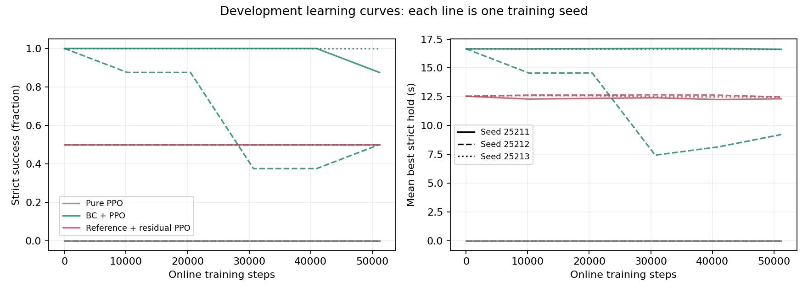
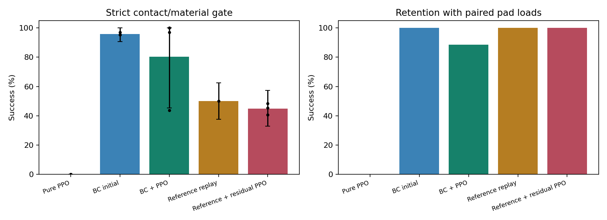
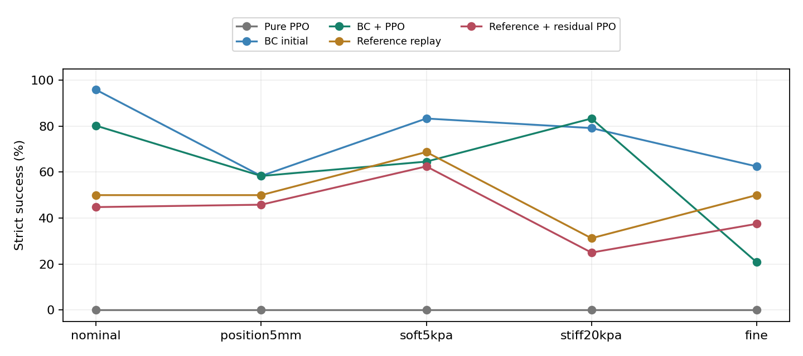

# S12 软体抓取实验统计

**状态：预定训练和评估数据已齐全。**

## 这次到底比较什么

同一个可变形圆柱、同一手部接近/抬升路径下，比较纯 PPO、BC 后 PPO、固定参考、参考加残差 PPO。BC 起点单列，避免把模仿学到的能力算成 PPO 改进。
每个学习方法三个训练种子，各 51200 在线步；统一评估末步。原有视频几何参考复用，但在软体环境重新采集示范，不是新 RGB 提取，也不是现实软体材料标定。

## 学习过程

开发集曲线可用于理解过程，最终表用独立初态，不能把两者混起来。完整首末、峰值和逐训练种子记录在 CSV。

## 独立测试

| 条件 | 方法 | 严格成功率 | 物理保持成功率 | 平均最佳保持/s | 最大应变/% | 最大穿透/mm | 单元塌陷率 |
|---|---|---:|---:|---:|---:|---:|---:|
| nominal | Pure PPO | 0.00% | 0.00% | 0.00 | 38.73 | 3.120 | 0.00% |
| nominal | BC initial | 95.83% | 100.00% | 16.20 | 15.53 | 0.864 | 0.00% |
| nominal | BC + PPO | 80.21% | 88.54% | 14.13 | 99.99 | 4.559 | 4.17% |
| nominal | Reference replay | 50.00% | 100.00% | 12.18 | 23.68 | 0.924 | 0.00% |
| nominal | Reference + residual PPO | 44.79% | 100.00% | 11.64 | 23.86 | 0.947 | 0.00% |
| position5mm | Pure PPO | 0.00% | 0.00% | 0.00 | 33.32 | 1.182 | 0.00% |
| position5mm | BC initial | 58.33% | 93.75% | 12.33 | 99.98 | 1.023 | 6.25% |
| position5mm | BC + PPO | 58.33% | 83.33% | 11.31 | 99.99 | 1.030 | 8.33% |
| position5mm | Reference replay | 50.00% | 93.75% | 13.60 | 100.00 | 1.173 | 6.25% |
| position5mm | Reference + residual PPO | 45.83% | 93.75% | 13.10 | 99.98 | 1.016 | 6.25% |
| soft5kpa | Pure PPO | 0.00% | 0.00% | 0.00 | 38.59 | 1.156 | 0.00% |
| soft5kpa | BC initial | 83.33% | 100.00% | 15.28 | 22.37 | 0.766 | 0.00% |
| soft5kpa | BC + PPO | 64.58% | 91.67% | 14.34 | 100.00 | 0.743 | 4.17% |
| soft5kpa | Reference replay | 68.75% | 100.00% | 14.86 | 28.54 | 0.774 | 0.00% |
| soft5kpa | Reference + residual PPO | 62.50% | 100.00% | 15.04 | 28.34 | 0.773 | 0.00% |
| stiff20kpa | Pure PPO | 0.00% | 0.00% | 0.00 | 34.27 | 2.748 | 0.00% |
| stiff20kpa | BC initial | 79.17% | 100.00% | 14.87 | 11.33 | 0.958 | 0.00% |
| stiff20kpa | BC + PPO | 83.33% | 97.92% | 14.69 | 48.05 | 1.717 | 0.00% |
| stiff20kpa | Reference replay | 31.25% | 100.00% | 9.00 | 14.85 | 0.949 | 0.00% |
| stiff20kpa | Reference + residual PPO | 25.00% | 100.00% | 8.33 | 14.87 | 0.975 | 0.00% |
| fine | Pure PPO | 0.00% | 0.00% | 0.00 | 53.06 | 2.494 | 0.00% |
| fine | BC initial | 62.50% | 100.00% | 13.38 | 16.85 | 1.027 | 0.00% |
| fine | BC + PPO | 20.83% | 91.67% | 5.88 | 24.13 | 0.961 | 0.00% |
| fine | Reference replay | 50.00% | 100.00% | 11.85 | 19.88 | 1.024 | 0.00% |
| fine | Reference + residual PPO | 37.50% | 100.00% | 10.01 | 19.99 | 1.029 | 0.00% |

物理保持仍要求撤支撑、抬升、拇指与另一手指指定正面持续承载十五秒，只不施加严格质量门槛；它不是单纯未掉落。
单元塌陷指局部体积比 <=0.05；其中非正值表示单元翻转，已超出有效材料模拟范围。这些回合仍计失败、保留在分母内，不当成正常掉落或真实材料损坏。出现塌陷时，本表描述的是策略与这套模拟器共同组成的系统表现，不能全部归因为真实抓取能力。具体失败原因另见 `failure_analysis.md`，物理有效性审计见 `verification.json`。

不同条件使用不同初态种子；曲线描述各条件的保留测试表现，不是同一个初态只改材料/网格的因果试验。方法之间的成对差值仅在同一条件内计算。

## PPO 真正增加了多少

| 条件 | 对比 | 成功率差/百分点 | 配对分层 bootstrap 95% 区间 |
|---|---|---:|---|
| nominal | BC + PPO - BC initial | -15.62 | [-51.56, +6.25] |
| nominal | Reference + residual PPO - Reference replay | -5.21 | [-12.50, +0.00] |
| nominal | BC + PPO - Pure PPO | +80.21 | [+45.31, +100.00] |
| nominal | Reference + residual PPO - Pure PPO | +44.79 | [+32.81, +57.29] |
| position5mm | BC + PPO - BC initial | +0.00 | [-18.75, +14.58] |
| position5mm | Reference + residual PPO - Reference replay | -4.17 | [-16.67, +0.00] |
| position5mm | BC + PPO - Pure PPO | +58.33 | [+31.25, +81.25] |
| position5mm | Reference + residual PPO - Pure PPO | +45.83 | [+22.92, +68.75] |
| soft5kpa | BC + PPO - BC initial | -18.75 | [-54.17, +18.75] |
| soft5kpa | Reference + residual PPO - Reference replay | -6.25 | [-25.00, +8.33] |
| soft5kpa | BC + PPO - Pure PPO | +64.58 | [+35.42, +93.75] |
| soft5kpa | Reference + residual PPO - Pure PPO | +62.50 | [+39.58, +85.42] |
| stiff20kpa | BC + PPO - BC initial | +4.17 | [-31.25, +31.25] |
| stiff20kpa | Reference + residual PPO - Reference replay | -6.25 | [-18.75, +0.00] |
| stiff20kpa | BC + PPO - Pure PPO | +83.33 | [+50.00, +100.00] |
| stiff20kpa | Reference + residual PPO - Pure PPO | +25.00 | [+6.25, +50.00] |
| fine | BC + PPO - BC initial | -41.67 | [-83.33, +8.33] |
| fine | Reference + residual PPO - Reference replay | -12.50 | [-37.50, +0.00] |
| fine | BC + PPO - Pure PPO | +20.83 | [+0.00, +54.17] |
| fine | Reference + residual PPO - Pure PPO | +37.50 | [+12.50, +75.00] |

区间跨 0 时，不能说本轮证明了稳定增益。只有三个训练种子，区间属于描述性证据；不能把相同网络在 64 个初态上的结果视为 64 个独立训练实验。参考回放只算一个控制器，不复制成三个独立来源。
全成功/全失败时 bootstrap 区间可能退化，不能解释为没有不确定性；`per_training_seed.csv` 另给每个固定策略的 Wilson 区间。

## 不能越过的结论边界

有限预算、单个水平圆柱、仿真状态、理想手部位置控制、未标定弹性材料；不能推广为实机或所有软物体成功率。粗细网格、严格接触与物理保持的差异必须保留。

## 数据位置

- `episodes.csv`：逐回合数据和完整轨迹路径。
- `per_training_seed.csv`：每个独立网络的成功数和分母。
- `paired_differences.csv`：同初态配对差值。
- `aggregate.csv`：各条件质量指标。
- `learning_curves.csv`、`training_first_last.csv`：训练过程。
- 上级 `protocol.json` 固定方案，`evaluation_plan.json` 绑定末步权重。
- 原理、术语、文献和开发失败见 `docs/experiments/S12/`。
